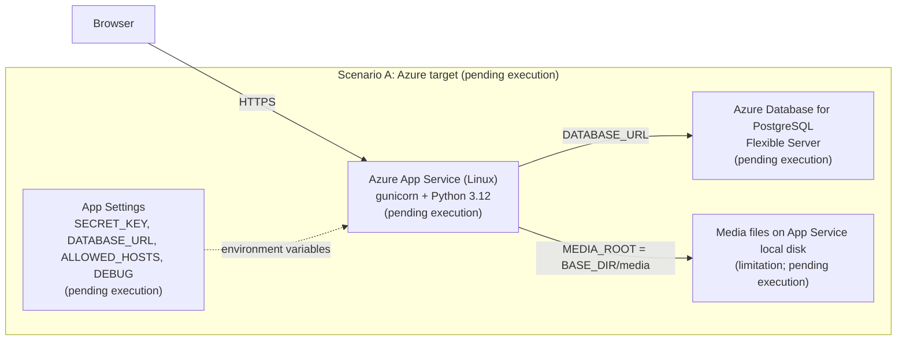
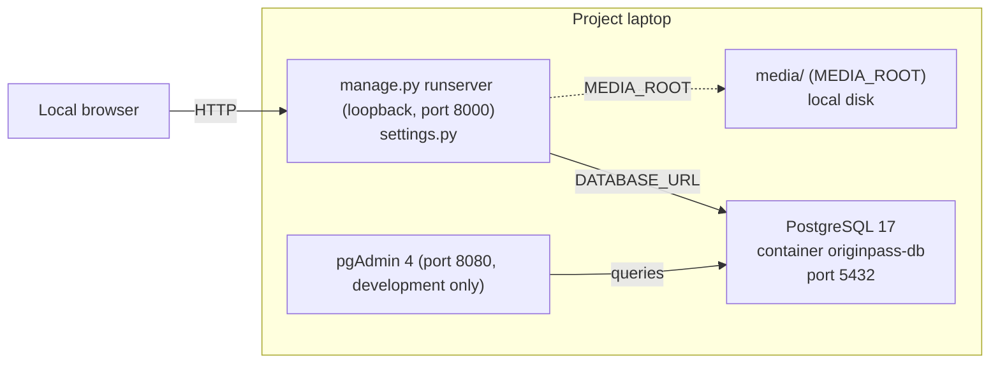
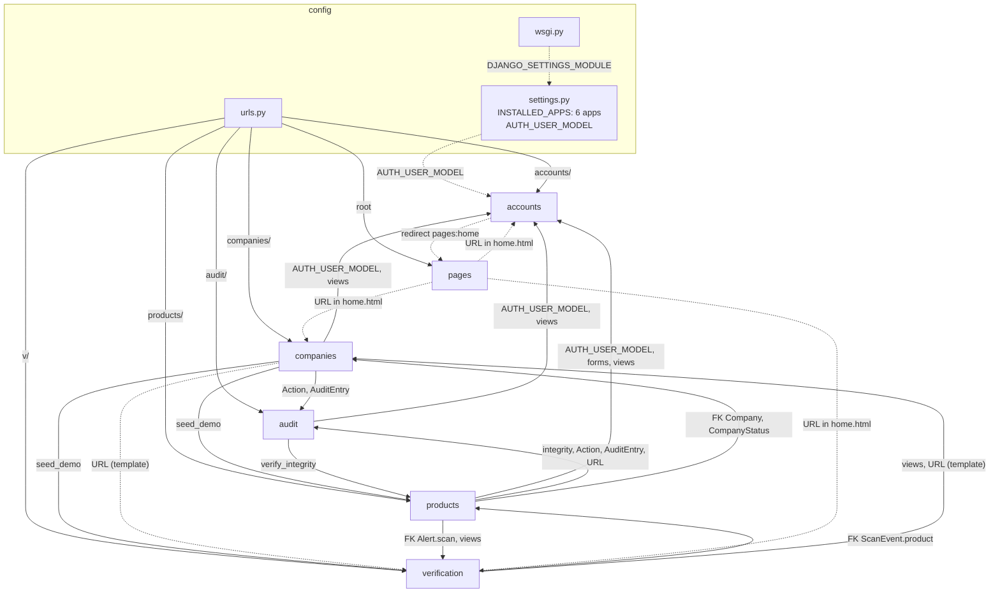
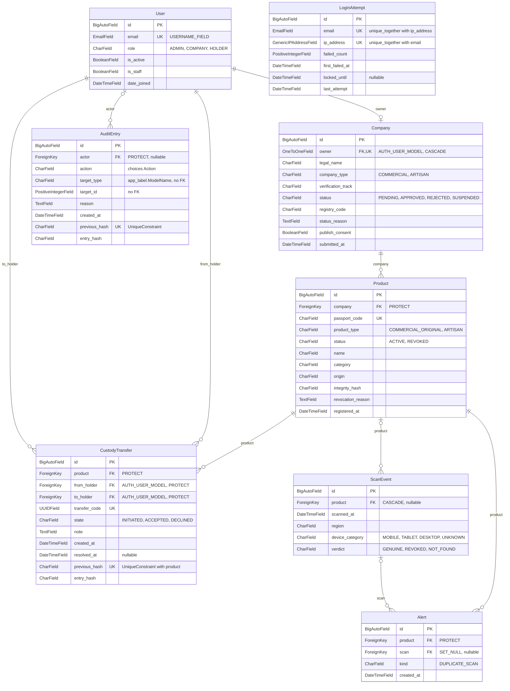

# OriginPass: Entregable 4 UML diagrams

Branch `d4/integracion-20261029`. Mermaid diagrams for the Wiki and the README. Artifacts are in English (course requirement; see `config/settings.py:114-118`). Everything related to Azure is pending execution.

## 1. Deployment

### 1.1 Scenario A: Azure target (pending execution)

- Pending execution: `README.md:303` states that the Azure deployment is not executed.
- Azure assets exist only as uncommitted working-tree files: `deploy/azure/desplegar-azure.ps1` (startup command `gunicorn --bind=0.0.0.0:8000 --workers=2 config.wsgi:application`, line 57), `deploy/azure/verificar-azure.ps1`, `deploy/azure/README-AZURE.md`. The repository has no Dockerfile (`deploy/azure/README-AZURE.md:15`).
- `gunicorn>=23.0,<24` is an uncommitted change in `requirements.txt:7`. It is absent at HEAD. The WSGI entry point is `config/wsgi.py:7`.
- Python 3.12: CI (`.github/workflows/ci.yml:39`), App Service runtime `PYTHON:3.12` (`deploy/azure/desplegar-azure.ps1:68`), and ruff target (`pyproject.toml:3`).
- Media limitation: `MEDIA_ROOT` points to `BASE_DIR/media` (`config/settings.py:134`). `config/urls.py:20-21` serves media only when `DEBUG=True`. Company logos (`companies/models.py:92`) and product images (`products/models.py:95`) are stored on that disk. `deploy/azure/README-AZURE.md:105` states that no persistent storage is configured.
- Static files: `STATIC_ROOT` (`config/settings.py:131`). With `DEBUG=0`, Django does not serve `/static/` without WhiteNoise, which is not in `requirements.txt` (`deploy/azure/README-AZURE.md:98`).
- App Settings: `SECRET_KEY` (`config/settings.py:32`), `DEBUG` (`:36`), `ALLOWED_HOSTS` (`:37`), `DATABASE_URL` (`:89`). The script sets `DATABASE_URL` in App Settings (`deploy/azure/desplegar-azure.ps1:75`).

### 1.2 Scenario B: project laptop (local)

- Server: `manage.py runserver` on `127.0.0.1:8000` (`README.md:136-139`; delivery kit: `delivery/Start-OriginPass.ps1:18`).
- PostgreSQL 17 in container `originpass-db` (`docker-compose.yml:2-10`; `README.md:96`, `README.md:126`). `docker-compose.yml:10` publishes `5432:5432` without a bind address, so on all interfaces. pgAdmin is bound to `127.0.0.1:8080` (`docker-compose.yml:42`). The README says `localhost:5432` (`README.md:126`).
- `DATABASE_URL` is loaded from `.env` (`config/settings.py:12`, `:89`).

## 2. Components

- Dependencies from production code: imports, string-referenced FKs, and URL-name references (``, `redirect`, `reverse`). Excluded: `tests/`, `test_support/`, `migrations/`, `tools/`, and `delivery/`, which are not apps.
- `config` registers the six apps (`config/settings.py:46-51`) and routes them (`config/urls.py:9-17`).
- `products` and `verification` reference each other in both directions (cycle).
- `AUTH_USER_MODEL = "accounts.User"` (`config/settings.py:93`): user FKs live in `companies`, `products`, and `audit`.
- The shared `templates/` directory (`templates/base.html`) links to URLs of every app. It is not an app and is not drawn.

## 3. Data model

- Entities: `User`, `LoginAttempt` (accounts); `Company` (companies); `Product`, `CustodyTransfer`, `Alert` (products); `ScanEvent` (verification); `AuditEntry` (audit). `pages` has no models.
- Omitted for brevity: descriptive text fields, images, `updated_at`, and most text fields of `Company`. The full list is in each `models.py`.
- `User` inherits `password` and `last_login` from `AbstractBaseUser`, and `is_superuser`, `groups`, and `user_permissions` from `PermissionsMixin` (`accounts/models.py:47`). Not drawn.
- `LoginAttempt` has no relations.
- `AuditEntry.target_type` / `target_id` is a logical reference without FK (`audit/models.py:44-55`). It records `companies.Company`, `products.Product`, or `products.CustodyTransfer` (`companies/models.py:245`, `products/models.py:215`, `products/models.py:383`). Not drawn.

## Sources

| Diagram | Element | Source (path:line) |
|---|---|---|
| 1.1 Azure | Pending status | `README.md:303` |
| 1.1 Azure | App Service Linux, gunicorn startup | `deploy/azure/desplegar-azure.ps1:57`, `:68`; `deploy/azure/README-AZURE.md:15` |
| 1.1 Azure | gunicorn (uncommitted) | `requirements.txt:7`; `config/wsgi.py:7` |
| 1.1 Azure | Python 3.12 | `.github/workflows/ci.yml:39`, `pyproject.toml:3` |
| 1.1 Azure | PostgreSQL Flexible Server, version 16 to confirm | `deploy/azure/desplegar-azure.ps1:70`; `deploy/azure/README-AZURE.md:12` |
| 1.1 Azure | App Settings | `config/settings.py:32`, `:36`, `:37`, `:89`; `deploy/azure/desplegar-azure.ps1:75` |
| 1.1 Azure | Media on local disk | `config/settings.py:134`; `config/urls.py:20-21`; `companies/models.py:92`; `products/models.py:95`; `deploy/azure/README-AZURE.md:105` |
| 1.1 Azure | Static files | `config/settings.py:131`; `deploy/azure/README-AZURE.md:98` |
| 1.2 Local | runserver on 127.0.0.1:8000 | `README.md:136-139`; `delivery/Start-OriginPass.ps1:18` |
| 1.2 Local | PostgreSQL 17 container, port 5432 | `docker-compose.yml:2-10`, `:3`; `README.md:96`, `README.md:126` |
| 1.2 Local | pgAdmin on 127.0.0.1:8080 | `docker-compose.yml:38-42` |
| 1.2 Local | DATABASE_URL from .env | `config/settings.py:12`, `:89` |
| 2 Components | config: wsgi, settings, urls | `config/wsgi.py:5`, `:7`; `config/settings.py:39-52`, `:93`; `config/urls.py:9-17` |
| 2 Components | Apps registered | `config/settings.py:46-51`; `config/urls.py:9-17` |
| 2 Components | companies → audit | `companies/models.py:14`; `companies/views.py:17` |
| 2 Components | companies → accounts | `companies/models.py:79`; `companies/views.py:14-16`; `companies/management/commands/seed_demo.py:17` |
| 2 Components | companies → products (seed_demo) | `companies/management/commands/seed_demo.py:19` |
| 2 Components | companies → verification (seed_demo) | `companies/management/commands/seed_demo.py:27` |
| 2 Components | companies → verification (URL) | `companies/templates/companies/public_profile.html:54` |
| 2 Components | products → accounts | `products/models.py:232`, `:235`; `products/forms.py:16`; `products/views.py:27-28` |
| 2 Components | products → audit | `products/models.py:21-22`; `products/views.py:29`; URL: `products/templates/products/admin_overview.html:14` |
| 2 Components | products → companies | `products/models.py:23`, `:82`; `products/views.py:30`; URL: `products/views.py:83`, `:120`, `:424`, `:502` |
| 2 Components | products → verification | `products/models.py:401`; `products/views.py:31`; URL: `products/views.py:183`, `:242`, `:584`, `:589` |
| 2 Components | audit → accounts | `audit/models.py:37`; `audit/views.py:14` |
| 2 Components | audit → products (verify_integrity) | `audit/management/commands/verify_integrity.py:15` |
| 2 Components | verification → products | `verification/models.py:29`; `verification/views.py:28` |
| 2 Components | verification → companies | `verification/views.py:27`; URL: `verification/templates/verification/verdict.html:70` |
| 2 Components | accounts → pages (redirect) | `accounts/views.py:49`, `:71`, `:113` |
| 2 Components | pages → accounts, companies, verification (URL) | `pages/templates/pages/home.html:35`, `:37`, `:39`, `:58`, `:71` |
| 3 Data model | Choices (enumerations) | `accounts/models.py:14-17`; `companies/models.py:17-32`; `products/models.py:26-39`; `audit/models.py:22-32`; `verification/models.py:14-24` |
| 3 Data model | User | `accounts/models.py:47-52`, `:56` |
| 3 Data model | LoginAttempt | `accounts/models.py:71-89`, `:92` |
| 3 Data model | Company | `companies/models.py:77-117`; constraints `:124-148` |
| 3 Data model | Product | `products/models.py:80-99`; constraint `:105-110` |
| 3 Data model | CustodyTransfer | `products/models.py:223-250`; constraints `:254-273` |
| 3 Data model | Alert | `products/models.py:396-413` |
| 3 Data model | ScanEvent | `verification/models.py:27-45` |
| 3 Data model | AuditEntry | `audit/models.py:35-79` |
| 3 Data model | User–Company (OneToOne) | `companies/models.py:78-82` |
| 3 Data model | Company–Product | `products/models.py:81-83` |
| 3 Data model | Product–CustodyTransfer; User–CustodyTransfer | `products/models.py:230-236` |
| 3 Data model | Product–Alert; ScanEvent–Alert | `products/models.py:399-406` |
| 3 Data model | Product–ScanEvent | `verification/models.py:28-35` |
| 3 Data model | User–AuditEntry | `audit/models.py:36-42` |

## Unconfirmed items

- Azure end to end: pending execution. The assets are uncommitted (`deploy/azure/`, `requirements.txt:7`).
- PostgreSQL version on Azure: `16`, marked "to confirm" (`deploy/azure/README-AZURE.md:12`). Local uses 17.
- Azure PostgreSQL firewall opened with `--public-access 0.0.0.0` (`deploy/azure/README-AZURE.md:63`, `:81`). Pending review.
- Serving static files with `DEBUG=False`: no WhiteNoise or alternative configuration.
- `DEBUG`, `ALLOWED_HOSTS`, and `DATABASE_URL` values for the laptop: they live in `.env`, which was not read.
- Port 5432 is published on all interfaces (`docker-compose.yml:10`), while the README says `localhost:5432`.
