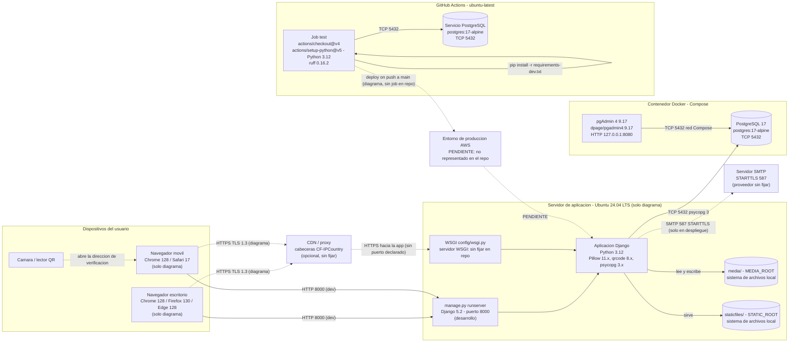

# D4-05 · Diagrama de despliegue OriginPass (código vigente en origin/main)

Alcance: lectura de `origin/main` del repo `OriginPass`. Ninguna versión se toma de memoria. Donde el repo no fija un dato se indica "sin fijar en repo". Las referencias `archivo:línea` apuntan a `origin/main`.

Fuentes leídas: `docker-compose.yml`, `docker/pgadmin/servers.json`, `pyproject.toml`, `requirements.txt`, `requirements-dev.txt`, `config/settings.py`, `config/wsgi.py`, `config/asgi.py`, `.github/workflows/ci.yml`, `README.md`, `docs/diagrams/deployment-model.drawio`, `delivery/docker-compose.kit.yml`, `tools/presentation/requirements.txt`.

No leído por restricción: `.env` / `.env.example` (bloqueado por el hook de seguridad y fuera de alcance para este entregable).

## 1. Tabla de componentes

| Componente | Tecnología | Versión | Fuente |
|---|---|---|---|
| Navegador de escritorio | Chrome / Firefox / Edge | Chrome 128 · Firefox 130 · Edge 128 (solo declarado en diagrama) | `docs/diagrams/deployment-model.drawio:30` (nodo "Desktop web browser"); no fijado en repo |
| Navegador móvil | Chrome / Safari | Chrome 128 · Safari 17 (solo declarado en diagrama) | `docs/diagrams/deployment-model.drawio:19`; no fijado en repo |
| Cámara / lector QR | Lector QR del dispositivo móvil | sin fijar en repo | `docs/diagrams/deployment-model.drawio:19-20` (nodo "Camera / QR reader") |
| Sistema operativo del servidor de aplicación | Ubuntu | 24.04 LTS (solo declarado en diagrama) | `docs/diagrams/deployment-model.drawio:39`; no fijado en repo, no hay Dockerfile ni IaC |
| Lenguaje de la aplicación | Python | 3.12 | `.github/workflows/ci.yml:39` (`python-version: "3.12"`); `README.md:94`; `pyproject.toml:3` (`target-version = "py312"`); patch exacto sin fijar en repo |
| Framework web | Django | >=5.2,<6.0 (rango, sin versión exacta) | `requirements.txt:1`; `README.md:95` menciona "Django 5.2" |
| Servidor WSGI (entrada de la app) | `django.core.wsgi.get_wsgi_application` | sin fijar en repo (no hay gunicorn/uWSGI/waitress en dependencias) | `config/wsgi.py:3-7`; `config/settings.py:84` (`WSGI_APPLICATION`) |
| Servidor de desarrollo | `manage.py runserver` | incluido con Django 5.2 | `README.md:136-139`; `docs/diagrams/deployment-model.drawio:47` (nodo "Django development server") |
| Interfaz ASGI | `get_asgi_application` | sin fijar en repo | `config/asgi.py:3-7`; `config/settings.py:85` |
| Servidor web / proxy inverso (nginx, Apache, etc.) | sin fijar en repo | sin fijar en repo | no aparece en el repo |
| Driver PostgreSQL | psycopg (binary) | >=3.2 (`requirements.txt:2`); 3.3 instalado según diagrama | `requirements.txt:2`; `docs/diagrams/deployment-model.drawio:76` |
| Conector de base de datos | dj-database-url | >=2.3 (`requirements.txt:3`); 3.1 según diagrama | `requirements.txt:3`; `config/settings.py:89` |
| Variables de entorno | python-dotenv | >=1.0 (`requirements.txt:4`); 1.2 según diagrama | `requirements.txt:4`; `config/settings.py:12` |
| Imágenes (logos, fotos de producto) | Pillow | >=11.0 (`requirements.txt:5`); 11.3 según diagrama | `requirements.txt:5`; `docs/diagrams/deployment-model.drawio:76` |
| Códigos QR | qrcode | >=8.0 (`requirements.txt:6`); 8.2 según diagrama | `requirements.txt:6` |
| Base de datos | PostgreSQL (imagen Docker) | 17 (tag `postgres:17-alpine`, sin patch fijado) | `docker-compose.yml:3`; `.github/workflows/ci.yml:15`; `README.md:96` |
| Orquestación local | Docker Compose | sin fijar en repo (archivo sin clave `version:`) | `docker-compose.yml:1` |
| Cliente de administración de BD | pgAdmin 4 (imagen Docker) | 9.17 (tag `dpage/pgadmin4:9.17`) | `docker-compose.yml:39` |
| Registro preconfigurado de pgAdmin | `servers.json` (Host `db`, puerto 5432, SSLMode `prefer`) | n/a | `docker/pgadmin/servers.json:4-10`; `docker-compose.yml:52` |
| Almacenamiento de archivos estáticos | Sistema de archivos local (`STATIC_ROOT`) | n/a | `config/settings.py:129-131`; no hay WhiteNoise ni servidor de estáticos en el repo |
| Almacenamiento de archivos media (logos, imágenes de producto) | Sistema de archivos local (`MEDIA_ROOT`) | n/a | `config/settings.py:133-134`; no hay django-storages ni S3 en dependencias |
| Correo transaccional | Backend de consola (desarrollo); SMTP en despliegue | STARTTLS, puerto 587 (solo declarado en diagrama) | `config/settings.py:143`; `docs/diagrams/deployment-model.drawio:140`; proveedor sin fijar en repo |
| CDN / proxy con cabeceras geográficas | Cloudflare (solo ejemplo en comentario) | sin fijar en repo | `config/settings.py:146-151` (`TRUST_GEO_HEADERS`); `docs/diagrams/deployment-model.drawio:143` |
| Transporte HTTPS | TLS 1.3 (declarado en diagrama) | sin fijar en repo (no hay configuración de certificados ni proxy en el repo) | `docs/diagrams/deployment-model.drawio:143-146`; `config/settings.py:157-160` (flags SSL, desactivados por defecto) |
| CI | GitHub Actions, runner `ubuntu-latest` | runner sin versión fija (etiqueta `ubuntu-latest`) | `.github/workflows/ci.yml:11` |
| Acción de checkout | `actions/checkout` | v4 | `.github/workflows/ci.yml:35` |
| Acción de Python | `actions/setup-python` | v5 | `.github/workflows/ci.yml:37` |
| Servicio PostgreSQL en CI | `postgres:17-alpine` | 17 | `.github/workflows/ci.yml:15` |
| Linter / formateador | Ruff | 0.16.2 (fijado) | `requirements-dev.txt:5` |
| Compilador de traducciones | GNU gettext (`compilemessages`) | sin fijar en repo (se instala con apt en CI) | `.github/workflows/ci.yml:47-53` |
| Repositorio y canalización de despliegue | GitHub (código), "deploy on push to main" | sin fijar en repo; el workflow solo tiene job `test` | `docs/diagrams/deployment-model.drawio:152`; `.github/workflows/ci.yml:9-10` |
| Entorno de producción en AWS | sin fijar en repo | sin fijar en repo | PENDIENTE (ver sección 4) |

## 2. Puertos y protocolos declarados

| Origen | Destino | Protocolo | Puerto | Fuente |
|---|---|---|---|---|
| Navegador | Aplicación Django | HTTP (dev) | 8000 | `README.md:139`; puerto por defecto de `runserver` |
| Navegador | Aplicación Django (despliegue) | HTTPS, TLS 1.3 | no declarado en repo | `docs/diagrams/deployment-model.drawio:143-146` |
| Aplicación Django | PostgreSQL | TCP, psycopg 3 | 5432 | `docs/diagrams/deployment-model.drawio:149`; `docker-compose.yml:10` |
| Host | PostgreSQL (contenedor `db`) | TCP | 5432:5432 publicado en todas las interfaces | `docker-compose.yml:9-10` |
| Host | pgAdmin (contenedor) | HTTP | 127.0.0.1:8080 → 80 | `docker-compose.yml:41-42` |
| pgAdmin | PostgreSQL (red interna Compose) | TCP | 5432 | `docker/pgadmin/servers.json:6-7` |
| Aplicación Django | Servidor SMTP | SMTP STARTTLS | 587 (solo diagrama) | `docs/diagrams/deployment-model.drawio:140`; `config/settings.py:143` |
| Cliente de CI | PostgreSQL (servicio CI) | TCP | 5432 | `.github/workflows/ci.yml:19-21`, `ci.yml:29` (`DATABASE_URL`) |
| Desarrollador | Base de datos (kit portátil) | TCP | 127.0.0.1:55432 → 5432 | `delivery/docker-compose.kit.yml:9` |

## 3. Diagrama de despliegue (Mermaid)

Nota de lectura: las líneas continuas son conexiones verificadas en el repo. Las punteadas son declaradas solo en el diagrama `docs/diagrams/deployment-model.drawio` o no tienen respaldo en el código.

## 4. Estado del entorno de producción

- El entorno de producción en AWS NO está representado en el repo. Búsqueda en `origin/main` de `aws`, `amazon`, `ec2`, `rds`, `s3`, `gunicorn`, `uwsgi`, `nginx`, `dockerfile`: sin resultados relevantes (la única coincidencia de "aws" es parte de la palabra "draws" en `docs/diagrams/deployment-model.drawio`).
- El repo no tiene Dockerfile, Procfile, IaC (Terraform, CloudFormation), buildspec ni job de despliegue en `ci.yml`.
- `README.md` (líneas 23-30) declara el repo como "MVP de trabajo" y dice que el despliegue es tema de Sprint 4. El diagrama (`deployment-model.drawio:157`) dice lo mismo: "Deployment is the subject of Sprint 4".
- **PENDIENTE: confirmar si existe un despliegue productivo en AWS, qué servicio lo aloja (EC2, ECS, Elastic Beanstalk, App Runner u otro), qué servidor WSGI y servidor web lo sirven, y dónde viven `media/` y `staticfiles/`.**

## 5. Observaciones de versiones y seguridad de despliegue (verificadas en código)

- La imagen de PostgreSQL se fija solo por tag mayor (`17-alpine`), no por patch (`docker-compose.yml:3`).
- El puerto 5432 se publica en todas las interfaces (`docker-compose.yml:10`, `"5432:5432"`), a diferencia de pgAdmin (`127.0.0.1:8080`, `docker-compose.yml:42`). El kit portátil sí lo liga a loopback (`delivery/docker-compose.kit.yml:9`).
- Las credenciales de PostgreSQL están en claro en `docker-compose.yml:6-8` (`originpass`/`originpass`) y en `ci.yml:17-19, 29`. Son de desarrollo; no deben usarse en producción.
- `SECURE_SSL_REDIRECT`, `SESSION_COOKIE_SECURE`, `CSRF_COOKIE_SECURE` y HSTS están apagados por defecto y se activan por variable de entorno (`config/settings.py:157-162`).
- `DEBUG` se lee de entorno con valor por defecto `False` (`config/settings.py:36`).
- `docker/pgadmin/servers.json` declara `SSLMode: "prefer"` (línea 10).

## 6. Resumen de PENDIENTE

1. PENDIENTE: despliegue productivo en AWS: servicio, región, instancia y dominio, no existen en el repo.
2. PENDIENTE: servidor WSGI en producción (gunicorn, uWSGI u otro) y su versión: no hay dependencia ni configuración en el repo.
3. PENDIENTE: servidor web o proxy inverso (nginx, Apache, ALB, etc.) y su versión: no aparece en el repo.
4. PENDIENTE: almacenamiento de `media/` y `staticfiles/` en producción (local, S3 u otro): solo hay configuración local en `config/settings.py:129-134`.
5. PENDIENTE: proveedor SMTP real y su configuración: solo hay backend de consola por defecto (`config/settings.py:143`).
6. PENDIENTE: certificado TLS, terminación HTTPS y puerto público: el diagrama declara TLS 1.3 sin respaldo en código.
7. PENDIENTE: versiones exactas de Django, psycopg, Pillow, qrcode, dj-database-url y python-dotenv instaladas en producción: el repo fija solo rangos; los números del diagrama (`deployment-model.drawio:51, 76`) no tienen lock file que los respalde.
8. PENDIENTE: patch exacto de Python 3.12 y de PostgreSQL 17 en producción.
9. PENDIENTE: sistema operativo real del servidor de aplicación: Ubuntu 24.04 LTS solo aparece en `deployment-model.drawio:39`.
10. PENDIENTE: pipeline de despliegue automático "on push to main" (`deployment-model.drawio:152`): el `ci.yml` solo ejecuta el job `test`.

Total de PENDIENTE: 10.
