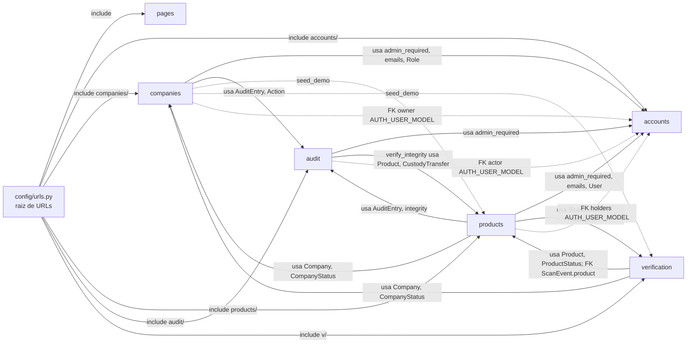

# D4-06 Diagrama de componentes de OriginPass

Fuente: `origin/main` (commit 81fbe6d). Todas las rutas son de ese commit. Se excluyen tests y migraciones.
Componentes = apps Django listadas en `config/settings.py:39-52` (`INSTALLED_APPS`): accounts, companies, products, verification, audit, pages. `config/` es configuración del proyecto, no una app; aparece solo como raíz de enrutamiento.

## 1. Diagrama

Leyenda: flecha continua = import de código; flecha punteada = clave foránea o comando de gestión.

## 2. Tabla de componentes

| Componente | Responsabilidad | URLs (`urls.py`) | Modelos | Depende de (verificado) | Dependen de él (verificado) | Requisitos (según mapa drawio) |
|---|---|---|---|---|---|---|
| **pages** | Página de inicio pública y créditos de fotografías. No tiene modelos. | `pages/urls.py:8-9`: `""` (home), `creditos/` (credits). Montado en `config/urls.py:9`. | Ninguno: no existe `pages/models.py` en origin/main. | Ninguna app. Solo `django.shortcuts` (`pages/views.py:11`). | `config/urls.py:9`. | Sin requisito asignado (`docs/diagrams/components-model.drawio:76`, "home ... reachable with no account"). |
| **accounts** | Registro, inicio y cierre de sesión, bloqueo por intentos fallidos, recuperación de contraseña con el flujo de Django, correos de decisión y roles. | `accounts/urls.py:13-15` (register, login, logout); `:16-43` (password-reset y sus subrutas). Montado en `config/urls.py:11`. | `User` (`accounts/models.py:47`), `LoginAttempt` (`:71`), `Role` (`:14`). | Ninguna app (`accounts/views.py:11-12` solo importa módulos propios). | `audit/views.py:14`; `companies/views.py:14-16`; `companies/management/commands/seed_demo.py:17`; `products/forms.py:16`; `products/views.py:27-28`. Modelo de usuario: `config/settings.py:93`, referenciado en `audit/models.py:37`, `companies/models.py:79`, `products/models.py:232,235`. | `register` FR01, FR02; `login` FR03, FR04, FR57; `logout` FR05; `password_reset` FR06; `emails` FR53, FR54, FR55 (`drawio:19-25`, `:270-273`). |
| **companies** | Solicitud y edición de la empresa, revisión administrativa (aprobar, rechazar), suspensión y reactivación, perfil público. | `companies/urls.py:8-17` (`application/`, `application/new/`, `application/edit/`, `review/...`, `<int:pk>/`). Montado en `config/urls.py:12`. | `Company` (`companies/models.py:77`, `owner` OneToOne en `:78`), `CompanyStatus` (`:28`), `CompanyType` (`:17`), `VerificationTrack` (`:22`), `TransitionNotAllowed` (`:58`). | `accounts` (`companies/views.py:14-16`); `audit` (`companies/models.py:14`, `companies/views.py:17`); `products` y `verification` solo en `seed_demo` (`companies/management/commands/seed_demo.py:19,27`). | `products/models.py:23`; `products/views.py:30`; `verification/views.py:27`; `seed_demo` no es dependiente. | `application_create` FR07, FR08, FR09; `application_edit` FR10, FR11; `application_detail` FR17, UR08; `review_list`/`review_detail` FR12; `review_approve` FR13; `review_reject` FR14; `suspend_company` FR15; `reactivate_company` FR16; `public_profile` FR18; DBR01, DBR11, DBR12 (`drawio:189-199`, `:33-54`, `:266-282`). |
| **products** | Catálogo y pasaporte del producto, código QR, custodia y traspasos entre titulares, analítica de escaneos para la empresa, revocación (por la empresa y por el admin), panel de administración y alertas. | `products/urls.py:8-21` (listado, alta, custodia, traspaso, analítica y CSV, panel admin, detalle, edición, QR, revocación). Montado en `config/urls.py:13`. | `Product` (`products/models.py:80`), `ProductType` (`:26`), `ProductStatus` (`:31`), `TransferState` (`:36`), `CustodyTransfer` (`:223`), `Alert` (`:396`), `AlertKind` (`:392`). | `accounts` (`products/forms.py:16`; `products/views.py:27-28`); `audit` (`products/models.py:21-22`; `products/views.py:29`); `companies` (`products/models.py:23`; `products/views.py:30`); `verification` (`products/views.py:31`; FK `products/models.py:400-401`). | `verification/views.py:28`; `audit/management/commands/verify_integrity.py:15`; `companies/management/commands/seed_demo.py:19`. | `product_create` FR19, FR20, FR21, FR23, UR10; `product_list` FR24, FR25; `product_edit` FR26; `qr_download` FR22; `transfer_initiate` FR35, FR38, FR39, FR54; `transfer_respond` FR36, FR37; `transfer_claim` FR40; `company_analytics` FR46-FR49, FR52; `company_analytics_csv` FR51; `product_revoke` FR41, FR55; `admin_revoke_product` FR42, FR55; `admin_overview` FR50 (`drawio:84-96`, `:266-270`, `:288-312`). |
| **verification** | Verificación pública del pasaporte por código (veredicto), búsqueda manual de código, registro de cada escaneo con su región y categoría de dispositivo, límite por hora por dirección IP, cadena de custodia pública. | `verification/urls.py:8-9` (`""` lookup, `<str:code>/` verify). Montado en `config/urls.py:17` bajo `v/`. | `ScanEvent` (`verification/models.py:27`, FK a `products.Product` en `:28-29`), `DeviceCategory` (`:14`), `Verdict` (`:21`). | `companies` (`verification/views.py:27`); `products` (`verification/views.py:28`; FK en `verification/models.py:29`). | `products/views.py:31`; `products/models.py:400-401` (FK a `ScanEvent`); `companies/management/commands/seed_demo.py:27`. | `verify` FR28, FR29, FR30, FR31 (`drawio:104`, `:181`, `:205`); escaneo con región FR33, alerta FR49, cap FR58 (`drawio:110`, `:211`). `verify` y `lookup` se implementan en `verification/views.py:106` y `:214`. |
| **audit** | Bitácora firmada y encadenada de acciones (`AuditEntry`), vista de consulta con filtros, comprobación de integridad de la cadena y descripción del esquema de base de datos. | `audit/urls.py:8` (`""` log). Montado en `config/urls.py:14`. | `AuditEntry` (`audit/models.py:35`, método `record` en `:108`), `Action` (`:22`). Firma y cadena en `audit/integrity.py`. | `accounts` (`audit/views.py:14`; `admin_required`); `products` solo en el comando `verify_integrity` (`audit/management/commands/verify_integrity.py:15`); AUTH_USER_MODEL en `audit/models.py:37`. | `companies/models.py:14`; `companies/views.py:17`; `products/models.py:21-22`; `products/views.py:29`. Comandos: `audit/management/commands/verify_integrity.py`, `audit/management/commands/describe_schema.py`. | `record_entry` FR43 (`drawio:62`); `audit_log` FR44, FR45 (`drawio:285`); `verify_integrity` FR45 (`drawio:65`); FR41-FR45 por sprint (`drawio:212`). `describe_schema` sin requisito (`drawio:68`). |

## 3. Hallazgos de verificación

1. **Discrepancia de dependencias en `verification`.** El mapa drawio dice que `verification` "depends on products, and on nothing else" (`docs/diagrams/components-model.drawio:181`). El código importa además `companies` (`verification/views.py:27`). El diagrama de este documento sigue el código.
2. **`record_scan` no es una función.** El mapa la nombra (`docs/diagrams/components-model.drawio:110`), pero en `verification/views.py` no hay `def record_scan`. El registro del escaneo ocurre dentro de `verify()` (`verification/views.py:120`, `ScanEvent.objects.create`).
3. **`record_entry` no es una vista.** Corresponde a `AuditEntry.record` (`audit/models.py:108`).
4. **Dependencia circular de modelos.** `products` referencia `verification.ScanEvent` (`products/models.py:400-401`) y `verification` referencia `products.Product` (`verification/models.py:29`). Ambas son referencias por cadena, así que no rompen la carga de modelos, pero sí hay ciclo entre las dos apps.
5. **FR34 no aparece en el código.** No hay referencia a FR34 en `*.py` de origin/main. La cuota de `verification/views.py:89-104` (`_under_scan_cap`) es por hora y está etiquetada FR58. La presentación (`tools/presentation/deck_content.py:393`) describe un límite por minuto etiquetado FR34.

## 4. PENDIENTE

1. PENDIENTE: componente y código que implementan FR27 (registro masivo por CSV). No está en el mapa drawio y no hay referencia en código; solo aparece en `docs/wiki/Deliverable-3.md:257` y `docs/GUIA-DEMO.md:80`.
2. PENDIENTE: componente que implementa FR34 (límite por minuto con mensaje de espera). No está en el mapa drawio y no hay referencia en código (ver hallazgo 5).
3. PENDIENTE: componente que implementa FR56 (publicar la cabeza de la cadena de integridad fuera del sistema). No está en el mapa drawio y no hay referencia en código; `docs/GUIA-DEMO.md:75` lo deja para Sprint 4.
4. PENDIENTE: componente que implementa FR32. Aparece en la tabla por sprint (`docs/diagrams/components-model.drawio:210`) pero no tiene función asignada en el mapa por componente.
