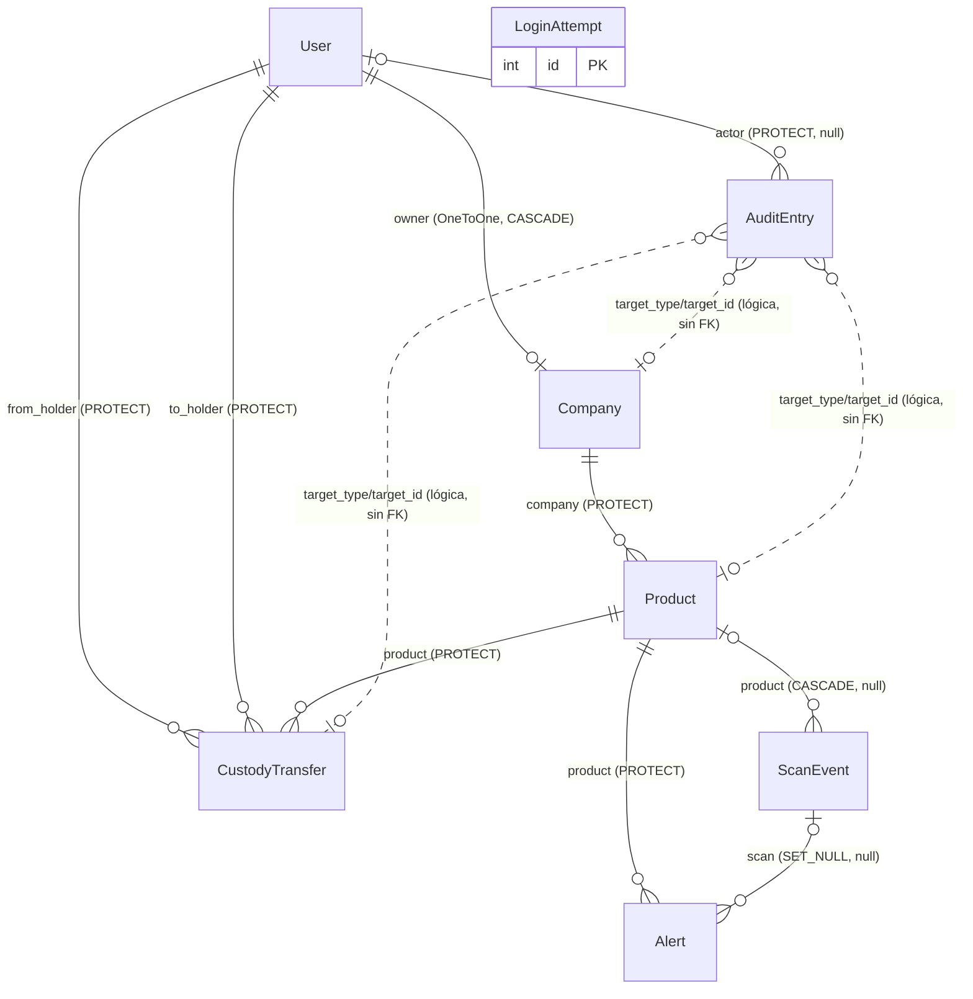

# D4-07 Modelo de datos relacional (OriginPass, origin/main)

Fuente: `git show origin/main:<ruta>` sobre `accounts/models.py`, `audit/models.py`, `companies/models.py`, `products/models.py`, `verification/models.py`. Todas las rutas son relativas al repo. Las líneas citadas corresponden a esa versión.

Convención: PK implícita `id` (AutoField de Django) en todas las entidades, porque ningún modelo declara `primary_key`. El tipo exacto depende de `DEFAULT_AUTO_FIELD` (ver PENDIENTE 1).

## (a) Diagrama entidad-relación

Notas de cardinalidad:
- `LoginAttempt` no tiene FK. Es independiente, con clave única compuesta `(email, ip_address)` (`accounts/models.py:92`).
- `AuditEntry.target_*` es una asociación polimórfica por cadena, no FK (`audit/models.py:44-54`). Las líneas punteadas del diagrama lo indican.

## (b) Tabla por entidad

| Entidad | Campo | Tipo | PK/FK | Restricción | Fuente |
|---|---|---|---|---|---|
| User | id | AutoField | PK | implícita | accounts/models.py:47 |
| User | email | EmailField | | unique | accounts/models.py:48 |
| User | role | CharField(16) | | choices Role, default HOLDER | accounts/models.py:49, 14-17 |
| User | is_active | BooleanField | | default True | accounts/models.py:50 |
| User | is_staff | BooleanField | | default False | accounts/models.py:51 |
| User | date_joined | DateTimeField | | default timezone.now | accounts/models.py:52 |
| User | password, last_login, is_superuser, groups, user_permissions | heredados | | de AbstractBaseUser y PermissionsMixin | accounts/models.py:8, 47 |
| User | (orden) | | | ordering email | accounts/models.py:59-60 |
| LoginAttempt | id | AutoField | PK | implícita | accounts/models.py:71 |
| LoginAttempt | email | EmailField | | parte de unique(email, ip_address) | accounts/models.py:84, 92 |
| LoginAttempt | ip_address | GenericIPAddressField | | parte de unique(email, ip_address) | accounts/models.py:85, 92 |
| LoginAttempt | failed_count | PositiveIntegerField | | default 0 | accounts/models.py:86 |
| LoginAttempt | first_failed_at | DateTimeField | | default timezone.now | accounts/models.py:87 |
| LoginAttempt | locked_until | DateTimeField | | null, blank | accounts/models.py:88 |
| LoginAttempt | last_attempt | DateTimeField | | auto_now | accounts/models.py:89 |
| LoginAttempt | (índice) | Index | | (email, -last_attempt) | accounts/models.py:93-95 |
| Company | id | AutoField | PK | implícita | companies/models.py:77 |
| Company | owner | OneToOneField(User) | FK | CASCADE, related_name company, único | companies/models.py:78-82 |
| Company | legal_name | CharField(200) | | | companies/models.py:83 |
| Company | company_type | CharField(16) | | choices CompanyType | companies/models.py:84, 17-19 |
| Company | verification_track | CharField(32) | | choices VerificationTrack; CHECK ligado a company_type | companies/models.py:85, 22-25, 125-137 |
| Company | status | CharField(16) | | choices CompanyStatus, default PENDING | companies/models.py:86-88, 28-32 |
| Company | description | TextField | | | companies/models.py:89 |
| Company | location | CharField(200) | | | companies/models.py:90 |
| Company | website | URLField | | blank | companies/models.py:91 |
| Company | logo | ImageField | | blank | companies/models.py:92 |
| Company | registry_code | CharField(64) | | blank; CHECK: obligatorio si COMMERCIAL | companies/models.py:93-97, 138-144 |
| Company | status_reason | TextField | | blank; CHECK: obligatorio si REJECTED o SUSPENDED | companies/models.py:98-101, 145-148, 55 |
| Company | evidence_notes | TextField | | blank | companies/models.py:102-108 |
| Company | publish_consent | BooleanField | | default False | companies/models.py:109-115 |
| Company | submitted_at | DateTimeField | | auto_now_add | companies/models.py:116 |
| Company | status_changed_at | DateTimeField | | default timezone.now | companies/models.py:117 |
| Company | (CHECK) | CheckConstraint | | company_track_matches_type | companies/models.py:124-137 |
| AuditEntry | id | AutoField | PK | implícita | audit/models.py:35 |
| AuditEntry | actor | ForeignKey(User) | FK | PROTECT, null, blank, related audit_entries | audit/models.py:36-42 |
| AuditEntry | action | CharField(32) | | choices Action (10 valores) | audit/models.py:43, 22-32 |
| AuditEntry | target_type | CharField(32) | | "app_label.Model", sin FK | audit/models.py:54 |
| AuditEntry | target_id | PositiveIntegerField | | sin FK, índice compuesto con target_type | audit/models.py:55, 67 |
| AuditEntry | reason | TextField | | blank | audit/models.py:56 |
| AuditEntry | created_at | DateTimeField | | default timezone.now | audit/models.py:59 |
| AuditEntry | previous_hash | CharField(64) | | default GENESIS, UNIQUE (cadena lineal) | audit/models.py:61, 68-79 |
| AuditEntry | entry_hash | CharField(64) | | blank, firmado | audit/models.py:62, 146 |
| AuditEntry | (save) | regla | | append-only: rechaza update | audit/models.py:84-87 |
| Product | id | AutoField | PK | implícita | products/models.py:80 |
| Product | company | ForeignKey(Company) | FK | PROTECT, related products | products/models.py:81-83 |
| Product | passport_code | CharField(64) | | unique, db_index, default generado | products/models.py:84-86, 51-57 |
| Product | product_type | CharField(32) | | choices ProductType; debe coincidir con company_type | products/models.py:87, 26-28, 142-150 |
| Product | status | CharField(16) | | choices ProductStatus, default ACTIVE | products/models.py:88-90, 31-33 |
| Product | name | CharField(200) | | | products/models.py:91 |
| Product | description | TextField | | | products/models.py:92 |
| Product | category | CharField(100) | | | products/models.py:93 |
| Product | origin | CharField(200) | | | products/models.py:94 |
| Product | image | ImageField | | blank | products/models.py:95 |
| Product | integrity_hash | CharField(64) | | blank, firma de signed_parts | products/models.py:96, 115-125 |
| Product | revocation_reason | TextField | | blank; CHECK si REVOKED | products/models.py:97, 105-110 |
| Product | registered_at | DateTimeField | | auto_now_add | products/models.py:98 |
| Product | updated_at | DateTimeField | | auto_now | products/models.py:99 |
| CustodyTransfer | id | AutoField | PK | implícita | products/models.py:74 |
| CustodyTransfer | product | ForeignKey(Product) | FK | PROTECT, related custody_transfers | products/models.py:81 |
| CustodyTransfer | from_holder | ForeignKey(User) | FK | PROTECT, related transfers_sent | products/models.py:82-84 |
| CustodyTransfer | to_holder | ForeignKey(User) | FK | PROTECT, related transfers_received; CHECK distinto de from_holder | products/models.py:85-87, 105-109 |
| CustodyTransfer | transfer_code | UUIDField | | unique, editable=False | products/models.py:90 |
| CustodyTransfer | state | CharField(16) | | choices TransferState, default INITIATED | products/models.py:91-93, 36-39 |
| CustodyTransfer | note | TextField | | blank | products/models.py:94 |
| CustodyTransfer | created_at | DateTimeField | | default timezone.now | products/models.py:97 |
| CustodyTransfer | resolved_at | DateTimeField | | null, blank | products/models.py:98 |
| CustodyTransfer | previous_hash | CharField(64) | | default GENESIS, UNIQUE(product, previous_hash) | products/models.py:100, 110-115 |
| CustodyTransfer | entry_hash | CharField(64) | | blank, firmado | products/models.py:101, 57 |
| CustodyTransfer | (índice parcial) | UniqueConstraint | | UNIQUE(product) WHERE state=INITIATED: una oferta abierta por producto | products/models.py:116-120 |
| CustodyTransfer | (save) | regla | | una vez resuelto no se edita | products/models.py:24-44 |
| Alert | id | AutoField | PK | implícita | products/models.py:137 |
| Alert | product | ForeignKey(Product) | FK | PROTECT, related alerts | products/models.py:140 |
| Alert | scan | ForeignKey(ScanEvent) | FK | SET_NULL, null, blank, related alerts | products/models.py:141-147 |
| Alert | kind | CharField(32) | | choices AlertKind (DUPLICATE_SCAN) | products/models.py:148, 133-135 |
| Alert | created_at | DateTimeField | | auto_now_add | products/models.py:149 |
| Alert | (UNIQUE) | UniqueConstraint | | (product, scan): una alerta por escaneo | products/models.py:153-155 |
| ScanEvent | id | AutoField | PK | implícita | verification/models.py:27 |
| ScanEvent | product | ForeignKey(Product) | FK | CASCADE, null, blank, related scan_events | verification/models.py:28-35 |
| ScanEvent | scanned_at | DateTimeField | | auto_now_add | verification/models.py:36 |
| ScanEvent | region | CharField(100) | | blank, grano grueso por diseño | verification/models.py:37, 3-5 |
| ScanEvent | device_category | CharField(16) | | choices DeviceCategory, default UNKNOWN | verification/models.py:38-40, 14-18 |
| ScanEvent | verdict | CharField(16) | | choices Verdict (GENUINE, REVOKED, NOT_FOUND) | verification/models.py:41, 21-24 |
| ScanEvent | (índice) | Index | | (product, scanned_at) | verification/models.py:45 |

## (c) Normalización

Resultado: el modelo cumple 1FN. Todos los campos son atómicos, sin listas ni grupos repetidos. Las dependencias funcionales de la mayoría de las entidades están en la clave. Hay dos violaciones claras de 3FN y varias redundancias deliberadas.

### 1FN
- Cumple. Cada campo es escalar (`accounts/models.py:47-52`, `products/models.py:80-99`). No hay JSON ni listas en columnas.

### 2FN
- Cumple. Todas las PK son simples (`id`). No hay dependencias parciales posibles. La única clave compuesta es `(email, ip_address)` en `LoginAttempt` (`accounts/models.py:92`), y todos sus no-clave dependen de la clave completa.

### 3FN: violaciones y dependencias transitivas

| # | Dependencia transitiva | Evidencia | Tratamiento actual | Propuesta (no implementada) |
|---|---|---|---|---|
| V1 | `company_type` → `verification_track` | `companies/models.py:38-44`, CHECK en `:125-137` | Se valida con CHECK, pero el valor se almacena | Tabla de catálogo `(company_type, verification_track)` y eliminar la columna, o derivarla con una propiedad |
| V2 | `product_type` ← `company.company_type` | `products/models.py:45-48`, validación en `:142-150` | Se valida en `Product.clean`, no con CHECK | Eliminar `product_type` y derivarlo por join con `Company`, o mantenerlo como snapshot justificado y documentarlo |
| R1 | `Alert.product_id` = `ScanEvent.product_id` cuando `scan` no es nulo | `products/models.py:140-147`, `verification/models.py:28-35` | Se conserva `product` a propósito porque `scan` puede pasar a NULL (SET_NULL) | Sin cambio. La redundancia es necesaria para no perder la relación si se borra el escaneo. Documentar la decisión |
| R2 | `CustodyTransfer.from_holder` = `to_holder` de la transferencia aceptada anterior, o `company.owner` | `products/models.py:82-84`, `:35-42`, validación en `:91` | Se almacena y se valida al crear | Derivable. Mantener como registro de evidencia, porque el registro es parte de la cadena firmada (`:70-74`). Documentar |
| R3 | `Product.current_holder` | `products/models.py:34-42` | Propiedad, no columna | Ya normalizado. No requiere cambio |
| R4 | `Product.integrity_hash` y `AuditEntry.entry_hash` | `products/models.py:96, 115-125`, `audit/models.py:62, 146` | Firma calculada sobre campos | Derivado por diseño (integridad). No es violación, pero si cambia un campo firmado el hash queda desactualizado. Mantener |
| R5 | `User.role` = COMPANY redundante con `Company.owner` | `accounts/models.py:14-17`, `companies/models.py:78-82` | Ambos existen | Propuesta: eliminar el valor COMPANY y derivar de la existencia de `Company`. Riesgo: el rol de admin también duplica `is_superuser` (`accounts/models.py:65-68`) |
| A1 | `AuditEntry.target_type` + `target_id` sin FK | `audit/models.py:44-55` | Asociación polimórfica intencional | Viola integridad referencial, no 3FN. Propuesta: FK nulas por tipo de destino (`company`, `product`, `custody_transfer`) con CHECK de exactamente una. Consecuencia: se pierde la uniformidad que sirve para la firma |
| A2 | `Company.status` y `Product` | `companies/models.py:86-88`, `products/models.py:140` | `Product.clean` valida que la empresa esté APPROVED en el momento de crear | Validación de aplicación, no de esquema. Sin cambio para 3FN |

### Resumen de propuestas
- No se implementa ninguna propuesta. Solo se documentan.
- Prioridad sugerida: V1 y V2 (dependencias transitivas reales). El resto son decisiones de diseño que el código ya justifica en comentarios.

## (d) PENDIENTE

1. PENDIENTE: valor de `DEFAULT_AUTO_FIELD` (`settings`), para confirmar si las PK son `AutoField` o `BigAutoField`. No se leyó el archivo de settings.
2. PENDIENTE: valor de `AUTH_USER_MODEL`, que se asume `accounts.User` por el uso en `audit/models.py:37`, `companies/models.py:79` y `products/models.py:83`. No se verificó en settings.
3. PENDIENTE: migraciones (`*/migrations/*.py`) de origin/main. No se leyeron. No se puede confirmar que el esquema real coincida con los modelos ni que existan los índices y constraints descritos.

Todos los models.py de origin/main fueron legibles. No hay otros modelos pendientes.

Total PENDIENTE: 3
