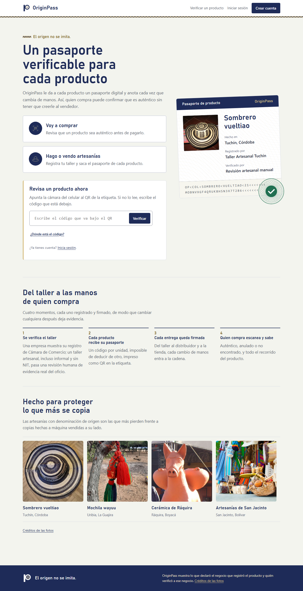
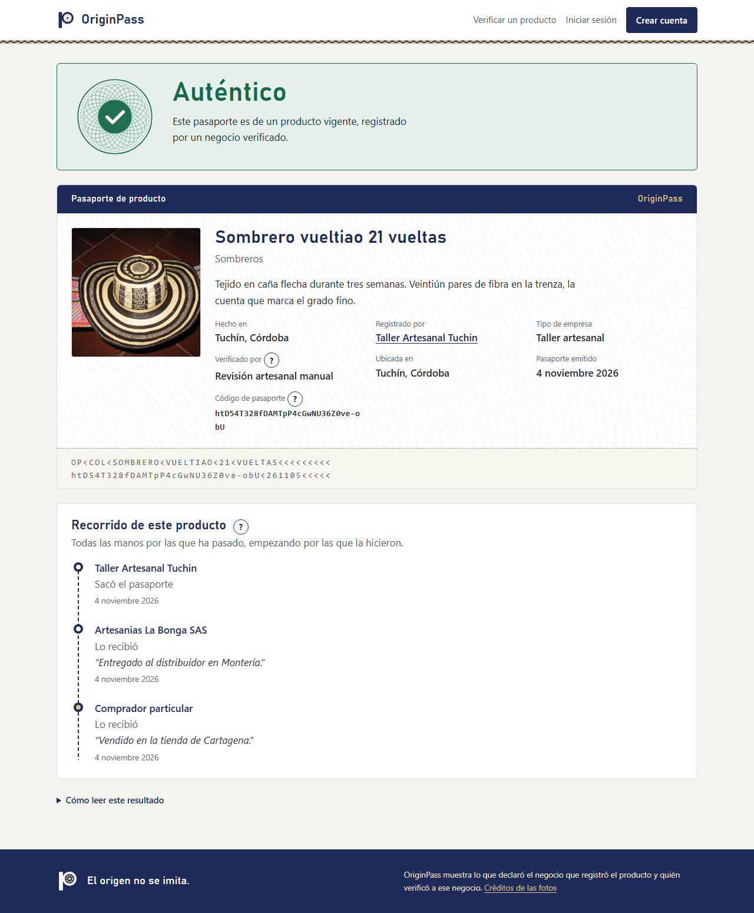
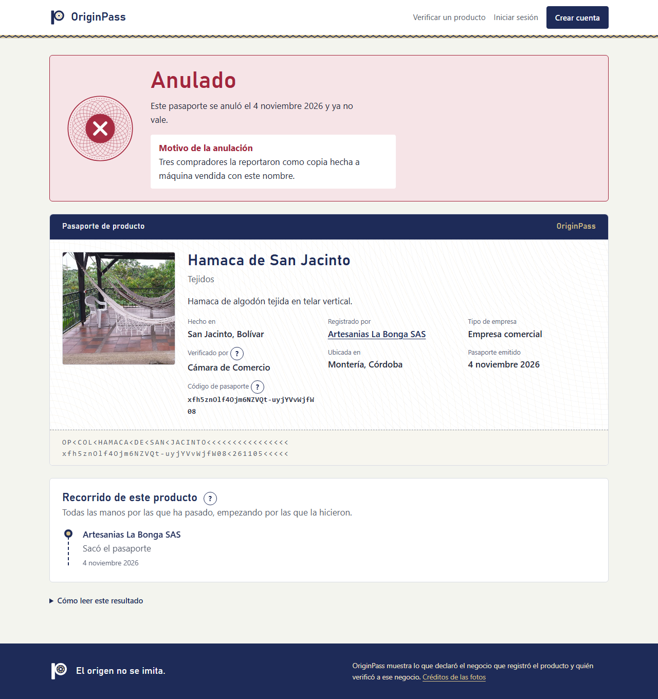
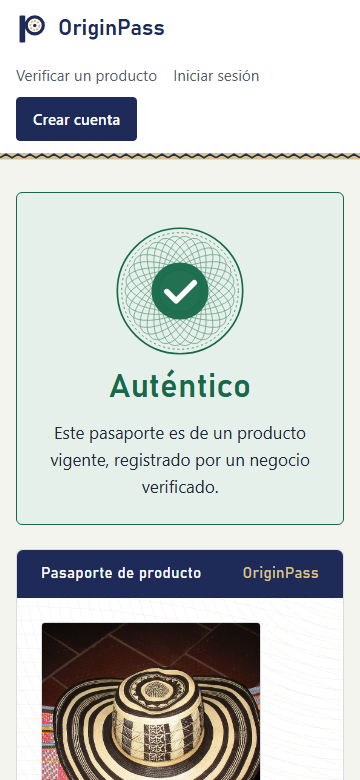
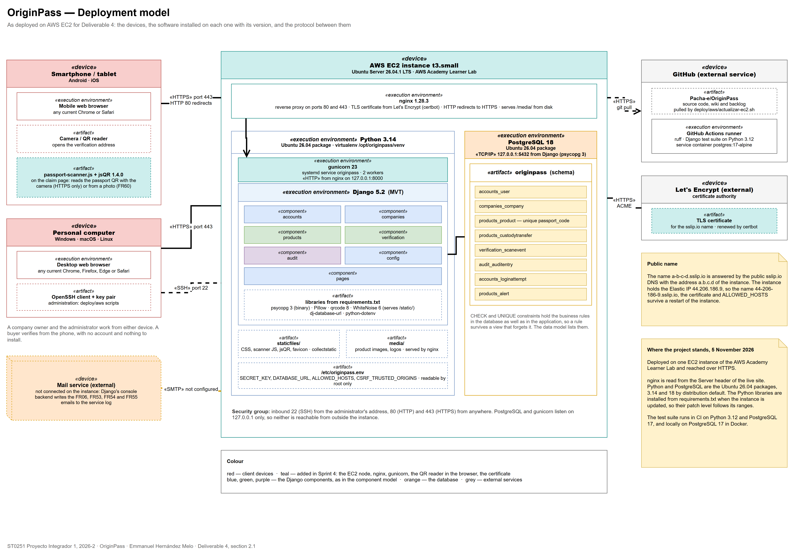
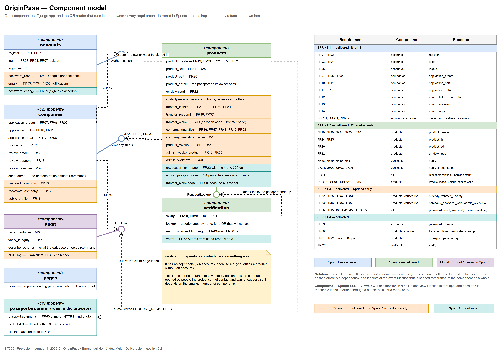
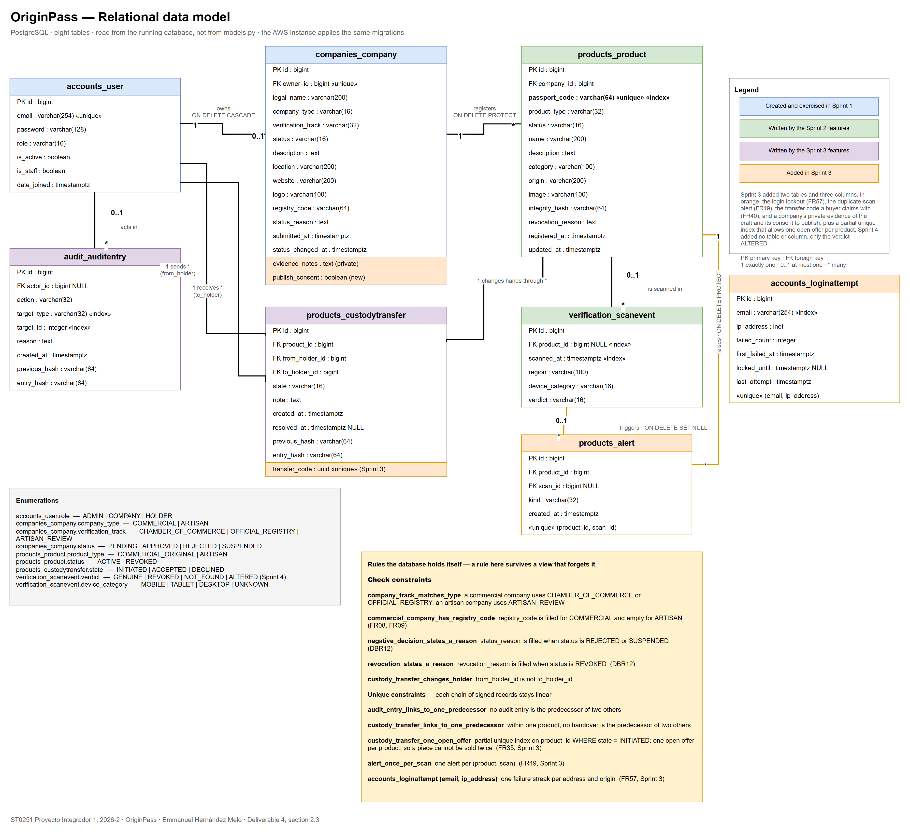
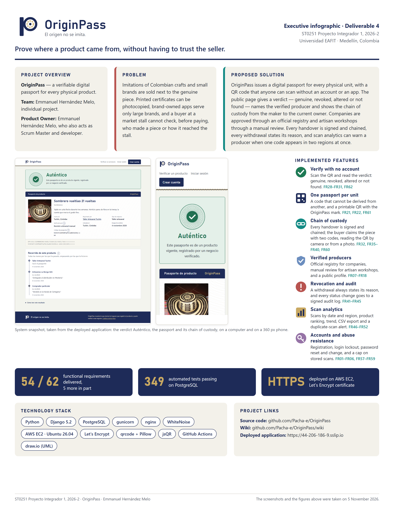

# Deliverable 4: PMV + Documentation

**Course:** ST0251 Proyecto Integrador 1, 2026-2
**Team 1 — OriginPass.** Emmanuel Hernández Melo, carried out individually; he is also the Product Owner and the Scrum Master ([Team](Team)).
**Sprint covered:** Sprint 4, 14 October to 10 November 2026. Status recorded on 5 November 2026.

**Repository:** https://github.com/Pacha-e/OriginPass, branch `main`.
**Deployed application:** https://44-206-186-9.sslip.io (AWS EC2, HTTPS). The instance holds an Elastic IP, so the address survives a restart of the instance; it answers while the Learner Lab instance is running. See 1.4.

OriginPass gives every physical product its own passport. A workshop or a company registers each unit and prints its QR; the piece passes from hand to hand along a signed chain of custody; any buyer scans the code and reads, with no account, whether the piece is genuine, who made it and where it has been. The vueltiao hat of Tuchín is the case the product was built around.

> **What this page does not claim.** No interview, survey or usability session with potential users has been run, so no element of the Product Vision Board is validated by users, and every figure the analytics show is demonstration data or comes from informal tests by the author. A verdict certifies the state of the record, not by itself the physical piece. Publishing the head of the integrity chain outside the server (FR56, with Monad as the target) is not built.

---

## 1. Validation of Product Vision and Course Requirements

### 1.1. Product Vision Board Validation

The initial definitions are the ones on the [Product Vision Board](Product-Vision-Board) page, written for Deliverable 1. "Achievement level" says what the product does about each one; none of them has been confirmed with real producers or buyers.

| Element | Initial Definition | Achievement Level | Evidence |
|---|---|---|---|
| Vision | Make the origin of any physical product provable, so that buying something genuine stops depending on trusting whoever is selling it. | **Met in the product, not measured.** Any buyer checks a unit with no account, and the answer comes from the registry, not from the seller. Whether it changes what people buy has not been measured. | Public verdicts FR28–FR31 and the journey FR32 (screenshots in 1.4); the verdict Altered when a record no longer matches its signature (FR62). |
| Target group | Artisan workshops; small and medium manufacturers; distributors and retailers; buyers; the platform administrator. | **Every group has its own flow; none has been consulted.** Workshop and company applications on two tracks, the distributor who receives and passes on a piece, the buyer who verifies and claims it, the administrator who reviews and revokes. The producer interviews and the buyer survey of the [Primary Research Plan](Primary-Research-Plan) were not run. | Demonstration accounts for each role in the README; FR07–FR18, FR35–FR42. |
| Needs | Prove that a unit came from a producer; check at the moment of purchase with no account; tell a verified producer from one who only claims it; show the route of the product; withdraw a passport; notice a copied passport. | **Five of six fully covered, one in part.** One code per unit (FR21), verification with no account (FR28), reviewed producers with a public profile (FR13, FR18), the chain of custody (FR32, FR35–FR40), withdrawal with a reason (FR41, FR42). Noticing a copy (FR49) works only where a CDN supplies the region, which the AWS instance does not have. | Section 1.3; limitations in section 6. |
| Product | Two verification tracks; one passport per unit; public verification with no barrier; a chain of custody that cannot be edited; scan analytics; reasoned withdrawal. | **All six built.** Commercial registry code or manual review of the craft (FR08, FR09); a code per unit that cannot be derived from another (FR21); verification with no login on any phone (FR28, UR01); accepted transfers kept as written (FR37, DBR06); analytics by day, region and product with the trend and a CSV export (FR46–FR52); every rejection, suspension and revocation stores its reason (FR14, FR15, FR41, FR42, DBR12). | Component diagram in 2.2; 349 automated tests. |
| Business Goals | Become the origin registry Colombian artisan sectors trust; protect denominations of origin at the point of sale; turn verification data into an early warning of counterfeiting; keep joining cheap enough for an informal workshop. | **Not reached.** No real workshop, company or buyer uses the platform yet. Joining costs nothing and needs no registry for a workshop (FR09), and the early warning exists as the duplicate-scan alert (FR49), but neither has been tried with the people it is for. | Section 6; the [Problem Validation](Problem-Validation) page. |

### 1.2. Data Analytics Requirement Validation

The analytics read the scan records the public verification page writes (FR33, DBR07). A scan record holds the product, the time, the coarse region and the device category, and no IP address or personal data. A company sees its own products in its analytics page; the administrator sees the platform as a whole.

| Analytics Feature | Data Used | Insight Generated | Decision Supported |
|---|---|---|---|
| Scans over a date range, per day (FR46) | Scan records of the company's products: product, timestamp | When and how often buyers check the company's pieces | Whether a fair, a shop or a new channel actually reached buyers |
| Distribution by region (FR47) | Scan records: coarse region | Where the pieces are being checked | Which regions to supply, and where pieces turn up that the company never sent |
| Ranking of products (FR48) | Scan records grouped by product | Which pieces draw the most checks | Which pieces to make more of, and which are most worth copying |
| Duplicate-scan alert (FR49) | Scans of one passport from two regions within 24 hours | A passport that is probably being copied | Whether to revoke the passport (FR41) and warn the holder (FR55) |
| Trend against the preceding period (FR52) | Scan counts in the range and in the preceding range of equal length | Growth or fall of verifications, as a percentage | Whether a change in sales had an effect |
| CSV export (FR51) | The same range | The data, ready to analyse outside the platform; cells that could run as spreadsheet formulas are neutralised | The company's own reports |
| Platform overview (FR50) | Status of every company and product | Totals per status | Which pending applications the administrator reviews first |

**Data behind it.** The figures on the deployed instance come from the demonstration dataset (`seed_demo`) and from the informal tests of 4 and 5 November. The instance has no CDN in front, so new scans record no region and the alert does not fire there; the alert shown in the demonstration is part of the dataset. The decisions in the last column are what the features are designed for, not decisions observed in users.

### 1.3. Project Requirements

All functional requirements of Deliverable 1 (FR01–FR55) and those added since (FR56–FR62), with their full text as written on the [Requirements Specification](Requirements-Specification) page. "Sprint" is the sprint in which the requirement was built. Every requirement is tracked as an issue in the [Backlog](https://github.com/users/Pacha-e/projects/1).

| Requirement | Identifier | Requirement Description | Developed (Yes / No) | Sprint | Responsible Team Member |
|---|---|---|---|---|---|
| Create an account with email and password | FR01 | THE OriginPass system SHALL PROVIDE a visitor WITH THE ABILITY TO create an account using an email address and a password, confirming the result within 3 seconds | Yes | 1 | Emmanuel Hernández Melo |
| Reject registration with an email already in use | FR02 | IF a visitor submits a registration form with an email address that is already registered THEN THE OriginPass system SHALL display a message stating that the address is in use, within 2 seconds | Yes | 1 | Emmanuel Hernández Melo |
| Log in with email and password | FR03 | THE OriginPass system SHALL PROVIDE a registered user WITH THE ABILITY TO log in with an email address and a password, granting access to the account within 3 seconds | Yes | 1 | Emmanuel Hernández Melo |
| Identical authentication error for an unknown email and a wrong password | FR04 | IF a user submits incorrect credentials during login THEN THE OriginPass system SHALL display an authentication error message that is identical for an unknown email address and for a wrong password, within 2 seconds | Yes | 1 | Emmanuel Hernández Melo |
| Log out | FR05 | THE OriginPass system SHALL PROVIDE an authenticated user WITH THE ABILITY TO log out, ending the session within 2 seconds | Yes | 1 | Emmanuel Hernández Melo |
| Request a password reset link by email | FR06 | THE OriginPass system SHOULD PROVIDE a registered user WITH THE ABILITY TO request a password reset link delivered to the registered email address, sent within 60 seconds of the request | Yes | 3 (planned for 4) | Emmanuel Hernández Melo |
| Submit a company application (legal name, type, description, location, website) with status Pending | FR07 | THE OriginPass system SHALL PROVIDE an authenticated user WITH THE ABILITY TO submit a company application containing a legal name, a company type, a description, a location and a contact website, stored with the status Pending within 3 seconds | Yes | 1 | Emmanuel Hernández Melo |
| Require an official registry code from commercial companies | FR08 | IF the applicant selects the commercial company type THEN THE OriginPass system SHALL require an official registry code before accepting the application | Yes | 1 | Emmanuel Hernández Melo |
| Accept artisan applications without a registry code, for manual review; consent to the public profile | FR09 | IF the applicant selects the artisan company type THEN THE OriginPass system SHALL accept the application without an official registry code and mark it for manual review | Yes | 1 | Emmanuel Hernández Melo |
| Edit and resubmit an application in Pending or Rejected status | FR10 | WHILE a company application holds the status Pending or the status Rejected THE OriginPass system SHALL PROVIDE its owner WITH THE ABILITY TO edit and resubmit the application | Yes | 1 | Emmanuel Hernández Melo |
| Refuse edits to Approved or Suspended applications, showing the reason | FR11 | IF a company application holds the status Approved or the status Suspended THEN THE OriginPass system SHALL refuse an edit requested by its owner and display the reason for the refusal | Yes | 1 | Emmanuel Hernández Melo |
| Administrator lists applications filtered by status | FR12 | THE OriginPass system SHALL PROVIDE the administrator WITH THE ABILITY TO list all company applications filtered by status, returning results within 3 seconds | Yes | 1 | Emmanuel Hernández Melo |
| Administrator approves a pending application | FR13 | THE OriginPass system SHALL PROVIDE the administrator WITH THE ABILITY TO approve a pending company application, changing its status to Approved within 3 seconds | Yes | 1 | Emmanuel Hernández Melo |
| Administrator rejects an application with a written reason | FR14 | THE OriginPass system SHALL PROVIDE the administrator WITH THE ABILITY TO reject a company application, storing a written reason together with the decision | Yes | 1 | Emmanuel Hernández Melo |
| Administrator suspends an approved company with a reason | FR15 | THE OriginPass system SHALL PROVIDE the administrator WITH THE ABILITY TO suspend an approved company, storing a written reason and withdrawing the ability of that company to register products | Yes | 3 (planned for 4) | Emmanuel Hernández Melo |
| Administrator reactivates a suspended company | FR16 | THE OriginPass system SHALL PROVIDE the administrator WITH THE ABILITY TO reactivate a suspended company, restoring the ability of that company to register products | Yes | 3 (planned for 4) | Emmanuel Hernández Melo |
| The owner sees the application status and the reason for a rejection or suspension | FR17 | THE OriginPass system SHALL display to a company owner the current status of the application together with the reason stored for a rejection or a suspension | Yes | 1 | Emmanuel Hernández Melo |
| Public profile for each approved company | FR18 | THE OriginPass system SHOULD display a public profile page for each approved company showing its name, type, location and verification track | Yes | 3 | Emmanuel Hernández Melo |
| An approved company registers a product (name, description, category, origin, image) | FR19 | IF the requesting company holds the status Approved THEN THE OriginPass system SHALL PROVIDE the company WITH THE ABILITY TO register a product recording its name, description, category, origin and image | Yes | 2 | Emmanuel Hernández Melo |
| Refuse product registration from a company that is not approved, with a reason | FR20 | IF the requesting company holds a status other than Approved THEN THE OriginPass system SHALL refuse the product registration and display the reason for the refusal | Yes | 2 | Emmanuel Hernández Melo |
| Generate a unique passport code that cannot be derived from another | FR21 | AFTER a product is registered THE OriginPass system SHALL generate a passport code that is unique across all product records and that cannot be derived from another passport code | Yes | 2 | Emmanuel Hernández Melo |
| Generate a downloadable PNG QR encoding the verification address | FR22 | AFTER a product is registered THE OriginPass system SHALL generate a QR image encoding the public verification address of that product, available for download in PNG format | Yes | 2 | Emmanuel Hernández Melo |
| Restrict product type according to company type | FR23 | THE OriginPass system SHALL restrict a commercial company to registering products of the commercial type and an artisan company to registering products of the artisan type | Yes | 2 | Emmanuel Hernández Melo |
| List own products filtered by status, within 3 s | FR24 | THE OriginPass system SHALL PROVIDE a company WITH THE ABILITY TO list the products it registered filtered by status, returning results within 3 seconds | Yes | 2 | Emmanuel Hernández Melo |
| Search own products by name, category or passport code | FR25 | THE OriginPass system SHOULD PROVIDE a company WITH THE ABILITY TO search the products it registered by name, category or passport code, returning results within 2 seconds | Yes | 2 | Emmanuel Hernández Melo |
| Edit descriptive fields without changing the product's passport code | FR26 | THE OriginPass system SHALL PROVIDE a company WITH THE ABILITY TO edit the descriptive fields of a product it registered, leaving the passport code of that product unchanged | Yes | 2 | Emmanuel Hernández Melo |
| Bulk product registration from a CSV file | FR27 | THE OriginPass system COULD PROVIDE a company WITH THE ABILITY TO register products in bulk from an uploaded CSV file, reporting one outcome per row of the file | No | — (planned for 4) | Emmanuel Hernández Melo |
| Open the verification page without authenticating | FR28 | THE OriginPass system SHALL PROVIDE any visitor WITH THE ABILITY TO open the verification page of a product from its passport code without authenticating | Yes | 2 | Emmanuel Hernández Melo |
| Verdict Genuine with product and verified company data | FR29 | IF a submitted passport code matches an active product THEN THE OriginPass system SHALL display the verdict Genuine together with the product data and the verified company that registered it, within 3 seconds | Yes | 2 | Emmanuel Hernández Melo |
| Verdict Revoked with the revocation date | FR30 | IF a submitted passport code matches a revoked product THEN THE OriginPass system SHALL display the verdict Revoked together with the date on which the product was revoked | Yes | 2 | Emmanuel Hernández Melo |
| Verdict Not found with an identical message for every unmatched code | FR31 | IF a submitted passport code matches no product record THEN THE OriginPass system SHALL display the verdict Not found using a message that is identical for every unmatched code | Yes | 2 | Emmanuel Hernández Melo |
| Show the chain of custody in chronological order on the verification page | FR32 | THE OriginPass system SHALL display on the verification page the chain of custody of the product in chronological order | Yes | 3 | Emmanuel Hernández Melo |
| Record a scan event with timestamp, coarse region and device category | FR33 | AFTER a verification page is opened THE OriginPass system SHALL record a scan event storing the timestamp, the coarse geographic region and the device category | Partly | 3 | Emmanuel Hernández Melo |
| Limit verification attempts per origin to a maximum per minute, with a wait message | FR34 | THE OriginPass system SHOULD limit verification attempts received from a single origin to a defined maximum per minute, answering each attempt beyond that maximum with a wait message | No | — (planned for 4) | Emmanuel Hernández Melo |
| The current holder transfers custody to another registered account | FR35 | IF a product holds the status Active THEN THE OriginPass system SHALL PROVIDE the current holder of that product WITH THE ABILITY TO transfer custody to another registered account | Yes | 3 | Emmanuel Hernández Melo |
| The receiving account accepts or declines the transfer | FR36 | AFTER a custody transfer is initiated THE OriginPass system SHALL PROVIDE the receiving account WITH THE ABILITY TO accept or to decline the transfer | Yes | 3 | Emmanuel Hernández Melo |
| An accepted transfer is appended to the chain of custody | FR37 | AFTER a custody transfer is accepted THE OriginPass system SHALL append the transfer to the chain of custody of the product recording the origin holder, the destination holder and the timestamp | Yes | 3 | Emmanuel Hernández Melo |
| Refuse a transfer requested by an account that is not the holder, with a reason | FR38 | IF a custody transfer is requested by an account that is not the current holder of the product THEN THE OriginPass system SHALL refuse the transfer and display the reason for the refusal | Yes | 3 | Emmanuel Hernández Melo |
| Refuse a transfer of a revoked product, with a reason | FR39 | IF a product holds the status Revoked THEN THE OriginPass system SHALL refuse each custody transfer requested for that product and display the reason for the refusal | Yes | 3 (corrected in 4) | Emmanuel Hernández Melo |
| Claim final ownership with a passport code and a transfer code | FR40 | THE OriginPass system SHOULD PROVIDE a buyer WITH THE ABILITY TO claim final ownership of a product using its passport code together with a transfer code issued by the seller | Yes | 3 | Emmanuel Hernández Melo |
| The company revokes its product with a written reason | FR41 | THE OriginPass system SHALL PROVIDE the company that registered a product WITH THE ABILITY TO revoke that product, storing a written reason together with the decision | Yes | 3 (planned for 4) | Emmanuel Hernández Melo |
| The administrator revokes any product with a written reason | FR42 | THE OriginPass system SHALL PROVIDE the administrator WITH THE ABILITY TO revoke any product, storing a written reason together with the decision | Yes | 3 (planned for 4) | Emmanuel Hernández Melo |
| Audit entry when the status of a company or product changes | FR43 | AFTER the status of a company or of a product changes THE OriginPass system SHALL append an entry to the audit log recording the actor, the action, the affected record, the stored reason and the timestamp | Yes | 3 (planned for 4) | Emmanuel Hernández Melo |
| Administrator lists audit entries filtered by actor, action or date | FR44 | THE OriginPass system SHOULD PROVIDE the administrator WITH THE ABILITY TO list audit log entries filtered by actor, by action or by date range, returning results within 3 seconds | Yes | 3 (planned for 4) | Emmanuel Hernández Melo |
| Keep each audit entry unchanged for the retention period | FR45 | THE OriginPass system SHALL keep each audit log entry in the state in which it was written for the retention period defined for the system | Partly | 3 (planned for 4) | Emmanuel Hernández Melo |
| Number of scans of the company's products over a date range, within 5 s | FR46 | THE OriginPass system SHALL display to a company the number of verification scans of its products over a selected date range, rendered within 5 seconds | Yes | 3 | Emmanuel Hernández Melo |
| Distribution of scans of the company's products by region | FR47 | THE OriginPass system SHALL display to a company the distribution of verification scans of its products by geographic region | Yes | 3 | Emmanuel Hernández Melo |
| Ranking of products by number of scans | FR48 | THE OriginPass system SHOULD display to a company the products it registered ranked by number of verification scans | Yes | 3 | Emmanuel Hernández Melo |
| Duplicate-scan alert when a code is scanned in more than one region within the defined window | FR49 | IF one passport code is scanned from more than one geographic region within a defined time window THEN THE OriginPass system SHALL raise a duplicate scan alert for the product carrying that code | Partly | 3 | Emmanuel Hernández Melo |
| Totals of companies and products grouped by status, for the administrator | FR50 | THE OriginPass system SHALL display to the administrator the totals of companies grouped by status and of products grouped by status | Yes | 3 | Emmanuel Hernández Melo |
| Export the analytics for the selected range as CSV | FR51 | THE OriginPass system SHOULD PROVIDE a company WITH THE ABILITY TO export the verification analytics of a selected date range as a CSV file | Yes | 3 (planned for 4) | Emmanuel Hernández Melo |
| Scan trend against the preceding period of equal length | FR52 | THE OriginPass system COULD display to a company the trend of verification scans measured against the preceding period of equal length | Yes | 3 (planned for 4) | Emmanuel Hernández Melo |
| Email the applicant the decision and the stored reason | FR53 | AFTER the administrator approves or rejects a company application THE OriginPass system SHOULD send an email to the applicant stating the decision and the stored reason | Yes | 3 (planned for 4) | Emmanuel Hernández Melo |
| Email the receiving account when a transfer starts | FR54 | AFTER a custody transfer is initiated THE OriginPass system SHOULD send an email to the receiving account requesting acceptance of the transfer | Yes | 3 (planned for 4) | Emmanuel Hernández Melo |
| Email the current holder when a product is revoked, with the reason | FR55 | AFTER a product is revoked THE OriginPass system COULD send an email to the current holder of that product stating the stored reason | Yes | 3 (planned for 4) | Emmanuel Hernández Melo |
| Publish the integrity chain head to a service outside the operator's control | FR56 | AFTER a day on which any signed record was written THE OriginPass system SHALL publish the head of the integrity chain to a service outside the operator's control, so that a later rebuild of the chain can be shown not to match what was published | No | — (planned for 4) | Emmanuel Hernández Melo |
| Block an email address for 15 min after more than 5 failed logins within 15 min, with the FR04 message | FR57 | IF more than 5 failed login attempts are submitted for one email address within 15 minutes THEN THE OriginPass system SHALL refuse each further attempt for that address for 15 minutes, answering with the same authentication error message stated in FR04 | Partly | 3 | Emmanuel Hernández Melo |
| Store at most 60 scan records per source address per hour; verdicts are still answered | FR58 | THE OriginPass system SHALL record at most 60 verification scans per source address per hour, answering each verification beyond that count with the verdict and without storing a scan record | Yes | 3 | Emmanuel Hernández Melo |
| Change the password of one's own account | FR59 | THE OriginPass system SHOULD PROVIDE a signed-in user WITH THE ABILITY TO change the password of the account by entering the current password and the new one, keeping the session open after the change | Yes | 4 | Emmanuel Hernández Melo |
| Read the passport QR on the claim page with the camera or a photo | FR60 | THE OriginPass system SHOULD PROVIDE an account claiming a product WITH THE ABILITY TO fill in the passport code by reading the product's QR code with the camera of the device or from an uploaded photograph, keeping typed entry as an alternative | Partly | 4 | Emmanuel Hernández Melo |
| Export printable QR codes for every passport | FR61 | THE OriginPass system SHOULD PROVIDE the operator WITH THE ABILITY TO export the QR code of every passport, revoked ones included and labelled with their status, as images printable at 300 dpi and as US Letter sheets of twelve codes | Yes | 4 | Emmanuel Hernández Melo |
| Verdict Altered for a record that no longer matches its signature | FR62 | IF the signed fields of a product record do not match their signature THEN THE OriginPass system SHALL answer the verification with the verdict Altered, showing no data of the product | Yes | 4 | Emmanuel Hernández Melo |

**Count.** 62 functional requirements: **54 developed, 5 developed in part, 3 not developed.**

| Identifier | Why it is "Partly" or "No" |
|---|---|
| FR27 | Not built. Products are registered one at a time. |
| FR33 | Time and device category are recorded on every scan. The region is read only from the geolocation headers a CDN adds, and only when the deployment declares one (`TRUST_GEO_HEADERS`), because without a CDN a client could write those headers itself and raise false alerts. The AWS instance has no CDN, so its scans carry no region. |
| FR34 | Not built. FR58 caps the scan records per address and hour but never refuses a verification, which is what FR34 asks for. The issue was closed by mistake on 6 October and reopened on 15 October. |
| FR45 | Audit entries cannot be edited or deleted through the application, and their signed chain shows any change made in the database. No retention period is defined. |
| FR49 | The alert is built and tested, but it needs the region of FR33, so it does not fire on the AWS instance. |
| FR56 | Records are signed and chained, and `verify_integrity` detects a change by anyone who holds only the database. Publishing the head of the chain outside the server, so that the operator cannot rebuild it unnoticed, is not built. |
| FR57 | The lockout counts failures per email address and source address together. Failures for one email spread across many addresses are not added up, which FR57 asks for. |
| FR60 | Reading from the camera is in place over HTTPS. Reading from an uploaded photo passes on generated images, but in the informal tests photographs of a QR shown on a computer screen were not read. Typing the code is always available. |

FR39 was built in Sprint 3 and corrected in Sprint 4: an offer opened before a passport was revoked could still be accepted after it. FR09 and FR18 were extended on 15 October without a new identifier.

### 1.4. Deployment Validation

**Deployment URL:** https://44-206-186-9.sslip.io

**Health check:** `https://44-206-186-9.sslip.io/healthz/` answers `{"status": "ok"}` when the application reaches its database. It answered so over HTTPS on 5 November 2026.

The application runs on one AWS EC2 instance of the AWS Academy Learner Lab: Ubuntu 26.04.1 LTS, nginx in front with a Let's Encrypt certificate, gunicorn and Django behind it, and PostgreSQL on the same instance. The steps to install and update it are in [`deploy/aws/README-AWS.md`](https://github.com/Pacha-e/OriginPass/blob/main/deploy/aws/README-AWS.md). The screenshots below were taken from the running instance on 5 November 2026.

| Screen | |
|---|---|
| Landing page |  |
| Verdict *Auténtico* with the journey of the piece: workshop, distributor, buyer |  |
| Verdict *Anulado* with its reason |  |
| Verdict on a phone |  |

**Deployment limitations**

- **The address depends on the Learner Lab.** The instance runs only while the lab session is open. Until 5 November its public IP changed each time it was started again, which forced a new certificate and new allowed hosts; it now holds an Elastic IP, so the address stays fixed while the lab exists. The sslip.io name is derived from that IP; a domain of its own is not registered.
- **One instance, no backup.** The database and the uploaded photos live on the disk of the instance. Terminating it deletes them.
- **No outgoing email.** No SMTP service is configured, so the notifications (FR53–FR55) and the password reset link (FR06) are written to the server's log instead of being sent.
- **No region on new scans** (see FR33 and FR49 in 1.3).
- **Demonstration data.** The products and companies are fictitious. The demonstration accounts share one known password, kept by the owner's decision so that each account can be opened in class; the administrator's password was changed.

---

## 2. System design

The three models are draw.io files in [`docs/diagrams/`](https://github.com/Pacha-e/OriginPass/tree/main/docs/diagrams), exported to PNG, SVG and vector PDF in [`docs/diagrams/export/`](https://github.com/Pacha-e/OriginPass/tree/main/docs/diagrams/export). **What Sprint 4 added is drawn in teal in each one**, with its own legend entry.

### 2.1. Deployment View

[`deployment-model.drawio`](https://github.com/Pacha-e/OriginPass/blob/main/docs/diagrams/deployment-model.drawio) · [PDF](https://github.com/Pacha-e/OriginPass/blob/main/docs/diagrams/export/deployment-model-Deployment-model.pdf)



| Node | Technologies and versions | Communicates with |
|---|---|---|
| Buyer's phone, holder's or company's computer | Any current browser; the QR reader of the claim page (jsQR 1.4.0) runs in the browser and needs HTTPS for the camera | EC2 instance, HTTPS 443 (HTTP 80 redirects) |
| Administrator workstation | Browser; OpenSSH with the Learner Lab key | EC2 instance, HTTPS 443 and SSH 22 |
| AWS EC2 instance, t3.small | Ubuntu Server 26.04.1 LTS; nginx 1.28.3 with the Let's Encrypt certificate, serving `/media/`; gunicorn 23 bound to `127.0.0.1:8000`; Django 5.2 with WhiteNoise 6 for `/static/`, psycopg 3, Pillow and qrcode, within the ranges of `requirements.txt`; configuration in `/etc/originpass.env` | PostgreSQL on `127.0.0.1:5432`; GitHub for updates |
| Database (same instance) | PostgreSQL from Ubuntu 26.04, listening only on `127.0.0.1` | — |
| GitHub | Repository, wiki, backlog; Actions runs the checks against `postgres:17-alpine` | The instance pulls `main` through `actualizar-ec2.sh` |
| Let's Encrypt | Issues and renews the certificate through certbot | The instance, HTTP-01 challenge on port 80 |

Python and PostgreSQL on the instance are the ones Ubuntu 26.04 LTS installs with its `python3` and `postgresql` packages; the diagram gives them as Python 3.14 and PostgreSQL 18, the versions that release ships. `python3 --version; psql --version` on the instance confirms them. Development and continuous integration use Python 3.12 and PostgreSQL 17.

### 2.2. Implementation View

[`components-model.drawio`](https://github.com/Pacha-e/OriginPass/blob/main/docs/diagrams/components-model.drawio) · [PDF](https://github.com/Pacha-e/OriginPass/blob/main/docs/diagrams/export/components-model-Component-model.pdf)



One component per Django app, plus the QR reader that runs in the browser. Business rules live in the models, validation in the forms, and the views orchestrate. The table at the right of the diagram maps every developed functional requirement to the component and the function that implements it.

| Component | Responsibility | Sprint 4 |
|---|---|---|
| `accounts` | Accounts, sessions, login lockout, password reset, notification emails | Password change for a signed-in account (FR59) |
| `companies` | Applications on two tracks, review, suspension, public profile | — |
| `products` | Passports, QR, chain of custody, claim, revocation, company analytics, platform overview | `qr.passport_qr_image` with the OriginPass mark; `export_passport_qr`, printable sheets (FR61); the claim page with the QR reader (FR60); offers refused once a passport is revoked (FR39) |
| `verification` | The public verdict, the scan record, the duplicate-scan alert | The verdict Altered (FR62) |
| `audit` | The signed, chained trail of every status change and the administrator's log | — |
| `pages` | Landing page, credits, health check | — |
| `passport-scanner` (browser) | Reads the QR from the camera or from a photo and fills the passport code | New in Sprint 4 (FR60) |

### 2.3. Data Model

[`data-model.drawio`](https://github.com/Pacha-e/OriginPass/blob/main/docs/diagrams/data-model.drawio) · [PDF](https://github.com/Pacha-e/OriginPass/blob/main/docs/diagrams/export/data-model-Data-model.pdf)



Eight tables in PostgreSQL, read from the running database rather than from the models: account, company, product, custody transfer, scan event, alert, audit entry and login attempt. The rules that SQL can state are held by the database as well as by the application, through five check constraints, five unique constraints and a partial unique index that allows one open offer per product, so they hold even for a write that never goes through the application.

Sprint 4 added no table and no column. It added the value `ALTERED` to the verdict of a scan (migration `verification.0002`) and a data migration that signs the status of each product as well (`products.0008`).

---

## 3. Usability analysis

No formal usability session with potential users has been run. A protocol with five tasks, success criteria and a questionnaire is ready in [`docs/d4/usabilidad-protocolo.md`](https://github.com/Pacha-e/OriginPass/blob/main/docs/d4/usabilidad-protocolo.md), and it is the first item of future work.

What exists is feedback from the professor and the Product Owner, and the informal tests the author ran on the deployed instance on 4 and 5 November: printing the QR sheets, claiming a product from a new account on a phone, and scanning the passports with a second person in another country. Each row is an issue found that way.

| Usability Issue | Severity (High / Medium / Low) | Improvement implemented |
|---|---|---|
| The interface used technical vocabulary that a rural artisan or farmer, one of the target users, would not follow (professor, 1 October) | High | One plain word per idea, a sentence under every action, a "?" with the meaning of each term and help before every field, in Sprint 3. A test fails if the technical vocabulary comes back. |
| There was no obvious way to add the photograph of a product already registered (Product Owner, 15 October) | Medium | The photo is added or replaced when the product is edited, in Sprint 3. |
| On the claim page, the buyer had to type the passport code by hand, which nobody does on a phone | High | The page reads the QR with the camera, or from a photo, and fills the code (FR60). |
| The photo upload was an unstyled file field, and on the phone it opened the camera with no way to choose a saved picture | Medium | A button in the style of the site; the phone now offers the gallery as well as the camera. |
| Some texts appeared in Spanish and others in English | Medium | The strings added since the last translation were translated and the catalogue rebuilt. |
| The photographs of the products did not load on the pages the QR codes open | High | nginx serves the uploaded images on the instance, since Django serves them only in development. |
| A QR printed at full page size is far too large for a hat or a bag | Medium | Small QR codes at 300 dpi with high error correction and the OriginPass mark in the centre, twelve per US Letter sheet, revoked ones labelled (FR61). |
| A photograph of a QR shown on a computer screen is not read | Medium | Not solved. The photo is now tried at several sizes, which reads generated images but not these photographs; typing the code remains available. |
| When the browser refuses the camera, the explanation is hidden together with the camera panel | Low | Not solved; found by the external audit. |

---

## 4. Repository

**Repository:** https://github.com/Pacha-e/OriginPass. The project is carried out individually, so every commit is by Emmanuel Hernández Melo. Each commit message states what changed and why, and names the requirement when there is one.

The [README](https://github.com/Pacha-e/OriginPass#readme) lists what has to be installed and the commands to run the program:

- **Before running:** Python 3.12, Docker with Docker Compose for PostgreSQL 17, and Git.
- **Libraries**, in [`requirements.txt`](https://github.com/Pacha-e/OriginPass/blob/main/requirements.txt): Django 5.2, psycopg 3 (binary), dj-database-url, python-dotenv, Pillow, qrcode, gunicorn and WhiteNoise. [`requirements-dev.txt`](https://github.com/Pacha-e/OriginPass/blob/main/requirements-dev.txt) adds the pinned linter, ruff.

```bash
git clone https://github.com/Pacha-e/OriginPass.git && cd OriginPass
docker compose up -d                  # PostgreSQL 17 on localhost:5432
python -m venv .venv
source .venv/Scripts/activate         # Linux and macOS: source .venv/bin/activate
pip install -r requirements-dev.txt   # the libraries above plus the linter
cp .env.example .env                  # then fill in SECRET_KEY
python manage.py migrate
python manage.py compilemessages      # needs GNU gettext; the compiled .mo is committed
python manage.py createsuperuser      # the platform administrator
python manage.py seed_demo            # optional demonstration data; requires DEBUG on
python manage.py runserver            # http://127.0.0.1:8000/
```

```bash
python manage.py test                              # the suite
python manage.py makemigrations --check --dry-run  # no model change left unmigrated
ruff check . && ruff format --check .              # lint and formatting
python manage.py verify_integrity                  # every signed chain intact
```

**Verified.** The last full run passed 349 tests on PostgreSQL 17. Continuous integration runs the same checks on every push to `main` and every pull request. The deployment scripts are in [`deploy/aws/`](https://github.com/Pacha-e/OriginPass/tree/main/deploy/aws): `instalar-ec2.sh` for the first installation and `actualizar-ec2.sh` for every update after it.

---

## 5. Executive Project Infographic

[](https://github.com/Pacha-e/OriginPass/blob/main/docs/d4/images/infographic.pdf)

One US Letter page, also as a [printable PDF](https://github.com/Pacha-e/OriginPass/blob/main/docs/d4/images/infographic.pdf). It is built from [`docs/d4/infographic/`](https://github.com/Pacha-e/OriginPass/tree/main/docs/d4/infographic) with `python docs/d4/infographic/build_infographic.py --url <address>`, so it is rebuilt whenever the address or the figures change.

---

## 6. Limitations and Future Work

### Technical limitations

- **Trust in the operator.** Records are signed with a key derived from the server's secret, so a change made by someone who holds only the database is detected, but the operator of the server could rebuild the chain. FR56 closes that and is not built.
- **Custody and concurrency.** The external audit of 5 November found that the state of a custody transfer and the time it was resolved are not part of its signature, that an offer validated against an earlier holder can still be accepted, and that some writes are not serialised against each other under concurrent requests. They are listed in the project's audit notes, to be fixed with a test each.
- **Single instance.** One machine, no automatic backup, no outgoing email (see 1.4). The installer is not safe to run again on an instance with data, because it would generate a new secret key and every existing signature would stop validating.
- **Scan region.** It depends on a CDN in front of the application; without one, scans carry no region and the copy alert does not fire.

### Functional limitations

- **The QR identifies a record, not the piece.** A photocopied label opens the same passport. The verdict says what the registry holds; the buyer still compares the piece with its photograph and description.
- **One photograph per product.** No gallery.
- **Reading a QR from a photo** fails on photographs of a screen (see section 3).
- **Spanish only.** The interface is served in Spanish; the switch to English (UR05) is not built.

### Features planned but not completed

| Requirement | Explanation |
|---|---|
| FR27, bulk registration from CSV ([#27](https://github.com/Pacha-e/OriginPass/issues/27)) | A Could. Registering one product at a time served the demonstration, and the sprint went to the deployment. |
| FR34, per-minute limit on verifications ([#34](https://github.com/Pacha-e/OriginPass/issues/34)) | FR58 already keeps the scan table from growing at will. A limit that refuses verdicts has to be designed so that a buyer with a real product is never refused, which needs per-address limits shared between workers. |
| FR56, publishing the head of the integrity chain outside the server ([#78](https://github.com/Pacha-e/OriginPass/issues/78)) | The Sprint 4 goal, with Monad as the target. Not started: the deployment and the audit fixes took the sprint. |
| UR05, switching the interface to English ([#60](https://github.com/Pacha-e/OriginPass/issues/60)) | The interface already goes through Django's translation machinery, so it needs the switch and an English catalogue. |

### Future enhancements

- **Validate with users.** Run the producer interviews, the buyer survey and the usability protocol before building anything else; it is the largest open item of the project.
- **Anchor the chain on Monad (FR56),** so that verification stops depending on whoever runs the server.
- **Tamper-evident labels.** A label that breaks when removed, or an NFC tag, would tie the passport to the piece itself.
- **A production deployment:** a domain of its own, a managed database with backups, an SMTP service and a CDN, which also gives the scans their region back.
- **A gallery and a richer public profile** for each workshop.

---

## 7. Project Management

### 7.1. Backlog

The [Backlog](https://github.com/users/Pacha-e/projects/1) holds one issue per requirement, each with its acceptance criteria, sprint, MoSCoW priority, status and responsible person; the full text of every requirement is on the [Requirements Specification](Requirements-Specification) page. Every item is assigned to Emmanuel Hernández Melo.

| Sprint 4 | Status |
|---|---|
| FR06, FR15, FR16, FR41–FR45, FR51–FR55, DBR08 | Done in Sprint 3, ahead of plan; FR45 in part |
| FR59, FR60, FR61, FR62 | Added and done in Sprint 4; FR60 in part |
| Deployment on AWS EC2 with HTTPS | Done on 5 November |
| Five defects of the external audit (login lockout, offers on revoked passports, stale company edits, demonstration data outside DEBUG, altered passports) | Done, each with a regression test that failed before the fix |
| FR27, FR34, FR56, UR05 | Open |

Acceptance criteria of the requirements added in Sprint 4, each checked by the tests named:

| Requirement | Acceptance criteria | Tasks | Tests |
|---|---|---|---|
| FR59 | With the current password the password changes and the session stays open; with a wrong one nothing changes | Password change and confirmation pages, link in the account menu | `accounts/tests/test_password_change.py` |
| FR60 | The claim page offers the camera and a photo; a QR read fills the passport code; typing still works | Vendor jsQR 1.4.0; `passport-scanner.js`; camera only over HTTPS; photo tried at several widths | `products/tests/test_claim_scanner.py` |
| FR61 | One image per passport, revoked ones labelled with their status; 300 dpi; US Letter sheets of twelve | `qr.passport_qr_image`; the `export_passport_qr` command | `products/tests/test_export_passport_qr.py`, `products/tests/test_qr_code.py` |
| FR62 | A product whose status or identifying fields were changed in the database answers Altered and shows none of its data | The verdict `ALTERED`; migrations that re-sign existing rows | `verification/tests/test_verdict_integrity.py` |

### 7.2. Weekly Meetings

The project has one member, so the professor asked for an individual day-by-day log in place of team-meeting minutes: the [Daily Log](Daily-Log). The [Development Log](Development-Log) answers the three questions each week. The weeks of Sprint 4:

| Week | What did I do last week? | What am I going to do this week? | Are there any obstacles in the way? |
|---|---|---|---|
| 14 to 15 October | Answered the Product Owner's feedback of 15 October (evidence of the craft, editable photo, seven demonstration products), fixed the CI failures and merged Sprint 3 through pull request #82; built the Sprint 3 presentation and walkthrough | FR56 and the deployment | Continuous integration had failed five times on lint before anyone looked |
| 16 October to 3 November | No commit reached `main`; the log does not reconstruct these weeks | — | The sprint's work did not move, the same shape as in earlier sprints |
| 4 to 5 November | Deployed on AWS EC2 with HTTPS; fixed the five audit defects; password change, printable QR codes, the QR reader on the claim page; translations; the update script; this documentation | The Sprint Review; the remaining audit findings | The Learner Lab changes the public address when the instance restarts; photo reading of screen photographs |

**Product Owner and professor.** The Product Owner's feedback of 15 October is answered in the first row above and on the [Deliverable 3](Deliverable-3) page. The professor's instruction to deploy on AWS rather than Azure was followed on 4 and 5 November.

### 7.3. Retrospective

The Sprint 4 retrospective is on the [Retrospectives](Retrospectives) page. It was written on 5 November, before the Sprint Review; what the review brings up is added to it afterwards.

---

## 8. Sprint Review

Given in class, on the deployed application.

**Pitch, by Emmanuel Hernández Melo.** A copy of a vueltiao hat sells next to the original and the buyer cannot tell them apart; printed certificates are photocopied and brand checkers serve only large brands. OriginPass gives each unit its own passport, which anyone checks from its QR with no account, and records every hand the piece passes through. It is built, tested and deployed; what is missing is validation with real producers and buyers, and anchoring the record outside the server.

**Demonstration**, with the printed QR sheets and the demonstration accounts, in the order of a piece's life:

1. A buyer scans the QR of the vueltiao hat with a phone: verdict *Auténtico*, the photograph, the workshop and the journey workshop → distributor → buyer (FR28, FR29, FR32).
2. The QR of a revoked piece answers *Anulado* with its reason (FR30, FR41).
3. The workshop's account: its passports, the analytics by day, region and product, and the copy alert (FR46–FR52).
4. The workshop offers a piece; a new account claims it on the phone by reading the QR with the camera and entering the transfer code (FR35–FR40, FR60).
5. The administrator: the platform overview, the applications and the signed audit log (FR12–FR16, FR44, FR50).

The requirements built in this sprint are those of section 7.1: the deployment, the reader on the claim page, the printable QR codes, the verdict Altered and the password change.
